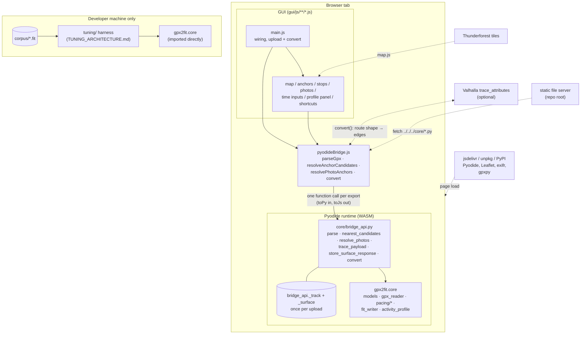
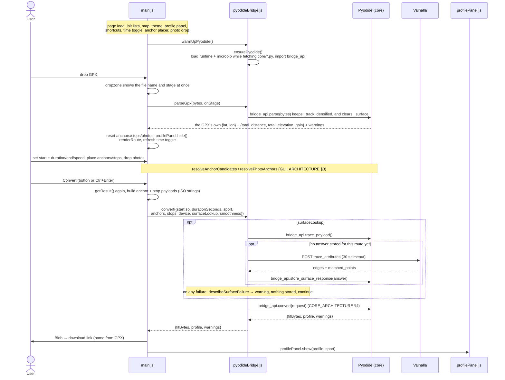
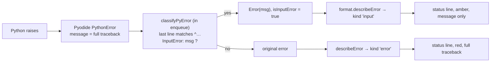

# Architecture

How the codebase is put together: which file owns what, how the files call
each other, and how a GPX file becomes a FIT file. This assumes you know what
the app does (see [README.md](../README.md)). Diagrams are Mermaid, which
GitHub renders. In PyCharm, enable Mermaid in *Settings → Languages &
Frameworks → Markdown*.

The map is split into four documents. This one holds what spans the whole
app: the rules, the repository, how the layers meet at the bridge, one
session end to end, and the errors.

| Document                                         | Covers                                                                                                                      |
|--------------------------------------------------|-----------------------------------------------------------------------------------------------------------------------------|
| **ARCHITECTURE.md** (this file)                  | design rules, repository map, system overview, the bridge, one session end to end, errors, cross-cutting checklists         |
| [CORE_ARCHITECTURE.md](CORE_ARCHITECTURE.md)     | the Python side, `src/gpx2fit/core/`: the data contract, every module, the data flow, what `bridge_api.convert()` runs      |
| [GUI_ARCHITECTURE.md](GUI_ARCHITECTURE.md)       | the browser side, `src/gpx2fit/gui/js/`: the module graph, who owns which state, the interaction flows, the smaller modules |
| [TUNING_ARCHITECTURE.md](TUNING_ARCHITECTURE.md) | the dev-only calibration harness in `tuning/`                                                                               |

Contents

1. [Design rules](#1-design-rules)
2. [Repository map](#2-repository-map)
3. [System overview](#3-system-overview)
4. [The bridge: `pyodideBridge.js` and `core/bridge_api.py`](#4-the-bridge-pyodidebridgejs-and-corebridge_apipy)
5. [One session end to end](#5-one-session-end-to-end)
6. [Errors](#6-errors)
7. [The tuning harness](#7-the-tuning-harness)
8. [Tests](#8-tests)
9. [Change checklists](#9-change-checklists)

---

## 1. Design rules

These rules shape the whole codebase. Breaking one of them means
redesigning, not refactoring.

| Rule                                                                                                                                                               | Why                                                                                                                                                                                                  |
|--------------------------------------------------------------------------------------------------------------------------------------------------------------------|------------------------------------------------------------------------------------------------------------------------------------------------------------------------------------------------------|
| **`core/` does no I/O.** Every function takes and returns bytes or dataclasses, never a file path, a network call, or `print()`.                                   | `core/` runs inside Pyodide in the browser. The network calls it needs (Valhalla) are made by JS, and the results are passed in as data.                                                             |
| **`core/` doesn't know about its interface.** No HTML, no CLI parsing.                                                                                             | The GUI is the only interface today, but a CLI could be added on top of `core/` unchanged.                                                                                                           |
| **One data contract.** Every module reads and writes the types in `core/models.py`.                                                                                | No module invents its own point or track shape. Stops and photos get their own input types, but they resolve down to `Anchor`/`TrackPoint` before pacing sees them.                                  |
| **Start and end are anchors.** A known time at distance 0, at the end, at a summit, from a photo, or at a stop's arrival/departure all use the same `Anchor` type. | `combine()` has one code path: fit between consecutive anchors. The average-speed entry is also just another way to set the end anchor's time. It's converted in JS, and `core/` never sees a speed. |
| **Two-stage inputs.** `RawAnchor → Anchor`, `RawStop → ResolvedStop \| ModeAStop`, `RawPhotoAnchor → ResolvedPhotoAnchor`.                                         | "Raw" is what the frontend can know (a click position, a distance). "Resolved" is pinned to a track point. Don't merge the two stages.                                                               |
| **Derived values are computed, not cached.** `Track.total_distance` and `start_time` are properties.                                                               | Pacing mutates `points` in place. A cached total could silently go stale, and recomputing costs almost nothing at this data size.                                                                    |
| **`SportType` is a closed enum and a dispatch key.**                                                                                                               | `curve_selection`, `surface`, `fit_writer` and `acceleration` (`MAX_ACCELERATION_MPS2`) branch on it. Adding cycling needs a new pacing model, not just a new enum value.                            |
| **`InputError` is a user-facing contract.**                                                                                                                        | Raise it only for problems the user can fix, with a plain-language message. See [§6](#6-errors).                                                                                                     |
| **Pacing is resolved per workout, fitted per segment.**                                                                                                            | Which curve to use, how much speed may swing, and the curve exponents are decided once from the whole track. Anchors only mark where a time is known, not where the terrain changes.                 |

---

## 2. Repository map

```
src/gpx2fit/
├── core/                         pure Python, loaded into Pyodide
│   ├── models.py                 data contract (all dataclasses + enums + InputError)
│   ├── gpx_reader.py             GPX bytes → Track
│   ├── fit_writer.py             paced Track → FIT bytes
│   ├── fit_encoder.py            the FIT byte layout, packed by hand (stdlib only)
│   ├── activity_profile.py       paced Track → ~1000 ProfileSamples for the chart
│   └── pacing/
│       ├── anchors.py            nearest-point lookup, boundary + user anchors
│       ├── stops.py              stop resolution (Mode A/B), track expansion
│       ├── photo_anchors.py      EXIF readings → matched track points + status
│       ├── gradient.py           smoothed gradients, Minetti/Tobler speed curves
│       ├── curve_selection.py    per-workout: Tobler weight, speed-swing bound, curve shape
│       ├── surface.py            Valhalla response → per-leg surface multipliers
│       ├── surface_weights.json  per-sport weight tables for surface.py
│       ├── variation.py          deterministic pace wander on steady stretches
│       ├── acceleration.py       per-sport limit on how fast the paced speed changes
│       └── combine.py            fits speeds to anchors, stamps timestamps
└── gui/
    ├── index.html                app shell; loads Leaflet and exifr from CDNs (SRI-pinned)
    ├── about.html                static About/privacy page
    ├── css/                      one stylesheet per component, linked in cascade order:
    │                             tokens, base, layout, forms, time, lists, buttons, map,
    │                             profile, dialogs, responsive, glass (+ about.css)
    ├── img/                      favicons (SVG, 144 px PNG) and apple-touch-icon, linked by both pages
    └── js/                       plain ES modules, no build (GUI_ARCHITECTURE.md)
        ├── main.js               entry point and wiring
        ├── config.js             Thunderforest key (gitignored; the deploy writes it here)
        ├── config.d.ts           config.js's shape, for the type check (optional, gitignored)
        ├── bridge/               pyodideBridge.js: the Pyodide runtime and every call into core/
        ├── state/                appState.js, settings.js, storage.js
        ├── route/                map.js, markerList.js, anchors.js, stops.js,
        │                         activityWindow.js, anchorOrder.js
        ├── placement/            anchorPopovers.js, stopPopover.js, candidatePicker.js,
        │                         timeChecks.js, placementEstimates.js, popoverParts.js,
        │                         popoverHost.js, photoPlacement.js, photoAnchors.js
        ├── inputs/               timeInput.js, speedEntry.js, dateTimeField.js,
        │                         numericInput.js, focusDropdown.js, segmented.js, dropzone.js
        ├── profile/              profileChart.js, profilePanel.js
        ├── devices/              devices.js, devicePicker.js
        ├── shell/                theme.js, glass.js, rangeFill.js, mobileLayout.js,
        │                         shortcuts.js, status.js
        └── util/                 format.js, dates.js, cssVars.js, dom.js

tuning/                           dev-only calibration harness (see TUNING_ARCHITECTURE.md)
tests/core/  tests/tuning/        pytest
tests/gui/                        node --test + jsdom, one folder per js/ folder
docs/                             ARCHITECTURE.md (this hub), CORE_ARCHITECTURE.md,
                                  GUI_ARCHITECTURE.md, TUNING_ARCHITECTURE.md
jsconfig.json  types/             npm run typecheck: tsc over js/ (types/ declares the CDN globals)
eslint.config.js                  npm run lint, over js/ and tests/gui/
valhalla_spike.html               standalone spike that proved Valhalla is CORS-open
```

---

## 3. System overview

Three runtime layers live in one browser tab. The tuning harness is a
separate offline tool that imports `core/` directly.



Ownership in short:

- **`appState.js`** holds the app's shared state: the parsed route (points,
  total distance, GPX file name), the chosen sport, and the start time with
  the start-time control's result, from which it derives the activity window.
  `main.js` creates the one instance, writes to it, and hands it to the
  modules that read it.
- **`pyodideBridge.js`** owns the Python runtime and is the only JS file that
  talks to Python. **`core/bridge_api.py`** is the only Python the bridge
  calls, and holds the parsed route.
- **Python** owns every calculation, including distances, nearest-point
  lookups, pacing and encoding. JS never computes a route distance itself.

---

## 4. The bridge: `pyodideBridge.js` and `core/bridge_api.py`

`pyodideBridge.js` is the only JS file that talks to Python, and every
call it makes goes to one function in `core/bridge_api.py`. That module
holds all the Python orchestration (building dataclasses from the GUI's
dicts, merging anchors and stops, the pipeline in [CORE_ARCHITECTURE.md §4](CORE_ARCHITECTURE.md#4-inside-bridge_apiconvert)),
so pytest and pyrefly cover it like any other `core/` module
(`tests/core/test_bridge_api.py`). It takes and returns plain dicts, lists,
numbers, strings and bytes. Its dict keys are the GUI's camelCase, except a
nearest-point candidate's, which is `nearest_point_candidates`' own dict.

| Export                              | `bridge_api` call                                                            | Returns                                                                                                                   |
|-------------------------------------|------------------------------------------------------------------------------|---------------------------------------------------------------------------------------------------------------------------|
| `parseGpx(bytes, onStage?)`         | `parse(bytes)`, which keeps the route as `_track`                            | `{points, summary, warnings}` for the map and sidebar; `onStage` hears `'engine'` (waiting for the runtime) and `'parse'` |
| `resolveAnchorCandidates(lat, lon)` | `nearest_candidates(lat, lon)`                                               | 1–4 candidates                                                                                                            |
| `resolvePhotoAnchors(readings)`     | `resolve_photos(readings)`, with no activity window                          | status per photo                                                                                                          |
| `convert({...})`                    | `trace_payload`, and `store_surface_response` once per route, then `convert` | `{fitBytes, profile, warnings}`                                                                                           |
| `warmUpPyodide()`                   | none                                                                         | starts loading the runtime on page load, unless the browser asks to save data                                             |
| `startPyodide()`                    | none                                                                         | starts loading it now (the user heads for the dropzone); a no-op once loaded or loading                                   |
| `classifyPyError(err)`              | none                                                                         | tags `InputError`s ([§6](#6-errors))                                                                                      |
| `describeSurfaceFailure(err)`       | none                                                                         | the warning for a failed surface lookup ([§6](#6-errors))                                                                 |

`parse` sends back only the GPX's own points, as `{lat, lon}`, for the map
line. The route it keeps is densified (legs ≤ `MAX_LEG_M`), but the added
points lie on straight lines, so the line looks the same. Sending the dense
route (until 2026-10-15) gave a 32 km planner GPX 17,165 points instead of
its 2,000, each drawn twice and scanned on every mouse move.

Four mechanisms keep the bridge working:

1. **Startup (`ensurePyodide`).** `main.js` calls `warmUpPyodide()` on
   page load, which starts this straight away (not when the browser asks to
   save data). Hovering, focusing or dragging over the GPX dropzone calls
   `startPyodide()`, which starts it if it isn't loaded or loading, so
   save-data mode or a failed warm-up still gets a head start. Otherwise,
   the first call does it. An upload that does wait says so on the dropzone
   (`parseGpx`'s `onStage`, shown by `dropzone.js`'s `createUploadLabel`).
   The setup:
   - add Pyodide's `<script>` from jsdelivr, pinned by `PYODIDE_VERSION`
     (the only place the version is written; `index.html` has no tag for it)
   - `micropip.install` `gpxpy`, pinned to the `uv.lock` version
     (`GPXPY_VERSION`)
   - meanwhile, fetch every file in `CORE_FILES` over HTTP from
     `../../../core/`, resolved against the bridge module's own URL
     (`import.meta.url`), so the site works whether the repo root or
     `src/gpx2fit/` is served
   - write them into `/workspace/src` in Pyodide's virtual filesystem
     (`FS.writeFile`), prepend that directory to `sys.path`, and
     `pyimport` `gpx2fit.core.bridge_api`

   A failed load (offline, a CDN hiccup) is forgotten, and a script tag that
   failed is removed, so the next call tries again.
   **A `core/` file that isn't in `CORE_FILES` doesn't exist in the
   browser**, and nothing warns about it until an import fails there.
2. **Plain values across, no proxies left behind (`callBridge`).** An
   object or array argument goes over with `pyodide.toPy` (a `Uint8Array`
   arrives as a memoryview, `undefined` as `None`), and the result comes
   back with `toJs` (dicts as plain objects, `bytes` as a `Uint8Array`).
   The argument proxies, the function proxy and the result proxy are all
   destroyed before the call returns, so no conversion's data stays alive in
   Python. Only the parsed route does, in `bridge_api._track`, so a GPX file
   is parsed once and reused for clicks, photos and every conversion. So
   do the surface multipliers read from Valhalla's answer for it, in
   `_surface` (see 5).
3. **Serial queue (`enqueue`).** Calls are chained on one promise.
   `convert` awaits the Valhalla request between `trace_payload` and
   `convert`, and a parse landing in that gap would swap the route under
   it. A failed call rejects only for its own caller, and the next call in
   the queue still runs. `ensureSurfaceResponse` isn't exported and isn't
   queued, because it runs inside `convert`'s queued task. Queueing it
   again would deadlock.
4. **Errors are classified once, in `enqueue`** ([§6](#6-errors)).
5. **One surface lookup per route.** Valhalla's answer depends only on the
   route (the sport only picks the weight table applied to it), so
   `store_surface_response` reads it with every sport's table once and
   `bridge_api` keeps each sport's multipliers, with their warnings, next
   to `_track` as `_surface`. `parse` clears them. `trace_payload` returns
   `None` once they're kept, and the bridge then skips the request. If
   reading the answer raises, nothing is kept, so an unusable answer, like
   a failed fetch, is a warning on this conversion and asked for again on
   the next. `convert` only looks its sport's multipliers up, and its
   `surfaceLookup` decides whether they're used, so unticking the checkbox
   needs no new request either way.

---

## 5. One session end to end

What each layer does from page load to a downloaded FIT file. The Python
side of the last step is in
[CORE_ARCHITECTURE.md §3–§4](CORE_ARCHITECTURE.md#3-data-flow-through-core),
and the clicks and drops in the middle in
[GUI_ARCHITECTURE.md §3](GUI_ARCHITECTURE.md#3-interaction-flows).



---

## 6. Errors



| Raise                         | When                                                                                                                                                                                                                                                                   |
|-------------------------------|------------------------------------------------------------------------------------------------------------------------------------------------------------------------------------------------------------------------------------------------------------------------|
| `InputError`                  | The user can fix it: corrupt GPX, two anchors on one point, a stop on an anchor, departure ≤ arrival, anchor times out of order with distance, stops longer than their segment. Write the message for the user: plain words, real km and times, and a hint at the fix. |
| `ValueError` / `RuntimeError` | A broken internal contract, i.e. a bug between the GUI and `core/`. The traceback is shown so it can be debugged.                                                                                                                                                      |

`combine._describe_anchor` formats an anchor for these messages, for
example "photo anchor at 5.30 km (2026-09-13 14:02)".

**Warnings** are the third channel: the conversion went through, but maybe
not as the user meant. Same writing rules as an `InputError` message.
- `parse_gpx_bytes`, `calculate_surface_multipliers` and `combine` take an
  optional keyword `warnings: list[str]` and append to it. Their return
  values don't change, so callers that don't care (tests, the tuning
  harness) pass nothing.
- `bridge_api` returns them as `warnings` from `parse` and `convert`, and
  the bridge from `parseGpx` and `convert`. The surface's come first: the
  JS side's own when the lookup failed (`describeSurfaceFailure`: a
  timeout, an HTTP error with Valhalla's own `error` text, no network, or an
  answer Python couldn't use), then Python's (surface unmatched for much of
  the route), then the pacing's.
- `format.statusWithWarnings` appends them to the success message as kind
  `'warning'`: amber (`.status-warning`) and, unlike `'input'`/`'error'`,
  not cleared on a timer.

| Warning                  | From                                                    |
|--------------------------|---------------------------------------------------------|
| Gap between segments     | `gpx_reader` (a join wider than 100 m)                  |
| Surface lookup failed    | the bridge (the request failed outright)                |
| Surface partly unmatched | `surface` (≥ 10% of the distance on the default 1.0)    |
| Implausible pace         | `combine` (a segment ≥ 300 m off by more than 2.5×)     |

---

## 7. The tuning harness

`tuning/` calibrates the pacing constants against real recorded activities.
It's development tooling that runs only on a developer's machine, and it's
documented separately in [TUNING_ARCHITECTURE.md](TUNING_ARCHITECTURE.md).

It touches the app in exactly three places:

- It imports `core/` directly (`gpx_reader`, `gradient`, `curve_selection`,
  `combine`, `anchors`, `models`) and never modifies it. Nothing from
  `tuning/` goes in `CORE_FILES`.
- `tuning/model.py` restates `combine._pace_segment` with the constants as
  arguments. `tests/tuning/test_model_mirror.py` asserts the two produce
  identical timestamps, so a change to `_pace_segment` or the resolvers in
  `curve_selection.py` means updating the mirror.
- What it proposes are new values for constants in `curve_selection.py`,
  applied by hand.

---

## 8. Tests

| Suite           | Location                            | Covers                                                                           |
|-----------------|-------------------------------------|----------------------------------------------------------------------------------|
| pytest, `core/` | `tests/core/`, `tests/core/pacing/` | see [CORE_ARCHITECTURE.md §5](CORE_ARCHITECTURE.md#5-tests)                      |
| pytest, harness | `tests/tuning/`                     | see [TUNING_ARCHITECTURE.md §13](TUNING_ARCHITECTURE.md#13-tests)                |
| node, GUI       | `tests/gui/`                        | see [GUI_ARCHITECTURE.md §5](GUI_ARCHITECTURE.md#5-tests), incl. what's untested |

---

## 9. Change checklists

These touch both sides. The ones that stay on one side are in
[CORE_ARCHITECTURE.md §6](CORE_ARCHITECTURE.md#6-change-checklists) and
[GUI_ARCHITECTURE.md §6](GUI_ARCHITECTURE.md#6-change-checklists).

**Adding a network call**
- Make it from JS (the bridge), never from `core/`.
- Treat a failure as optional if you can.
- Update `about.html#privacy` and the README's privacy table.

**Adding a sport**
- Extend `SportType`.
- Add the sport to every `SportType`-keyed table: `TOBLER_THRESHOLDS`,
  `DEFAULT_TOBLER_WEIGHT`, `MAX_SPEED_RATIO_BOUNDS`, `CURVE_FILLS`,
  `MAX_ACCELERATION_MPS2`, `fit_writer`'s `RECORD_INTERVAL_S` and
  `FIT_SPORT`, and `surface_weights.json`. `tests/core/test_sport_tables.py`
  fails until every one has it; none falls back to another sport's entry.
- Add a segment in the GUI's sport control whose `data-value` is the
  `SportType` value (`bridge_api` reads the sport as `SportType(value)`).
- Cycling also needs its own speed model in `gradient.py`.
