# Architecture

How the codebase is put together: which file owns what, how the files call
each other, and how a GPX file becomes a FIT file. This assumes you know what
the app does (see [README.md](../README.md)). The calibration harness in
`tuning/` has its own document,
[TUNING_ARCHITECTURE.md](TUNING_ARCHITECTURE.md). Diagrams are Mermaid,
which GitHub renders. In PyCharm, enable Mermaid in *Settings → Languages &
Frameworks → Markdown*.

Contents

1. [Design rules](#1-design-rules)
2. [Repository map](#2-repository-map)
3. [System overview](#3-system-overview)
4. [The data contract: `models.py`](#4-the-data-contract-modelspy)
5. [`core/` module by module](#5-core-module-by-module)
6. [The bridge: `pyodideBridge.js`](#6-the-bridge-pyodidebridgejs)
7. [The GUI](#7-the-gui)
8. [End-to-end code flow](#8-end-to-end-code-flow)
9. [Errors](#9-errors)
10. [The tuning harness](#10-the-tuning-harness)
11. [Tests](#11-tests)
12. [Change checklists](#12-change-checklists)

---

## 1. Design rules

These rules shape the whole codebase. Breaking one of them means
redesigning, not refactoring.

| Rule                                                                                                                                                               | Why                                                                                                                                                                                                  |
|--------------------------------------------------------------------------------------------------------------------------------------------------------------------|------------------------------------------------------------------------------------------------------------------------------------------------------------------------------------------------------|
| **`core/` does no I/O.** Every function takes and returns bytes or dataclasses, never a file path, a network call, or `print()`.                                   | `core/` runs inside Pyodide in the browser. The network calls it needs (Valhalla) are made by JS, and the results are passed in as data.                                                             |
| **`core/` doesn't know about its interface.** No HTML, no CLI parsing.                                                                                             | The GUI is the only interface today, but a CLI could be added on top of `core/` unchanged.                                                                                                           |
| **One data contract.** Every module reads and writes the types in `core/models.py`.                                                                                | No module invents its own point or track shape. Stops and photos get their own input types, but they resolve down to `Anchor`/`TrackPoint` before pacing sees them.                                  |
| **Start and end are anchors.** A known time at distance 0, at the end, at a summit, from a photo, or at a stop's arrival/departure all use the same `Anchor` type. | `combine()` has one code path: fit between consecutive anchors. The average-speed entry is also just another way to set the end anchor's time. It's converted in JS, and `core/` never sees a speed. |
| **Two-stage inputs.** `RawAnchor → Anchor`, `RawStop → ResolvedStop \| ModeAStop`, `RawPhotoAnchor → ResolvedPhotoAnchor`.                                         | "Raw" is what the frontend can know (a click position, a distance). "Resolved" is pinned to a track point. Don't merge the two stages.                                                               |
| **Derived values are computed, not cached.** `Track.total_distance` and `start_time` are properties.                                                               | Pacing mutates `points` in place. A cached total could silently go stale, and recomputing costs almost nothing at this data size.                                                                    |
| **`SportType` is a closed enum and a dispatch key.**                                                                                                               | `curve_selection`, `surface`, `fit_writer` and `acceleration` (`MAX_ACCELERATION_MPS2`) branch on it. Adding cycling needs a new pacing model, not just a new enum value.                            |
| **`InputError` is a user-facing contract.**                                                                                                                        | Raise it only for problems the user can fix, with a plain-language message. See [§9](#9-errors).                                                                                                     |
| **Pacing is resolved per workout, fitted per segment.**                                                                                                            | Which curve to use, how much speed may swing, and the curve exponents are decided once from the whole track. Anchors only mark where a time is known, not where the terrain changes.                 |

---

## 2. Repository map

```
src/gpx2fit/
├── core/                         pure Python, loaded into Pyodide
│   ├── models.py                 data contract (all dataclasses + enums + InputError)
│   ├── gpx_reader.py             GPX bytes → Track
│   ├── fit_writer.py             paced Track → FIT bytes
│   ├── fit_encoder.py            the FIT byte layout, packed by hand (stdlib only)
│   ├── activity_profile.py       paced Track → ~1000 ProfileSamples for the chart
│   └── pacing/
│       ├── anchors.py            nearest-point lookup, boundary + user anchors
│       ├── stops.py              stop resolution (Mode A/B), track expansion
│       ├── photo_anchors.py      EXIF readings → matched track points + status
│       ├── gradient.py           smoothed gradients, Minetti/Tobler speed curves
│       ├── curve_selection.py    per-workout: Tobler weight, speed-swing bound, curve shape
│       ├── surface.py            Valhalla response → per-leg surface multipliers
│       ├── surface_weights.json  per-sport weight tables for surface.py
│       ├── variation.py          deterministic pace wander on steady stretches
│       ├── acceleration.py       per-sport limit on how fast the paced speed changes
│       └── combine.py            fits speeds to anchors, stamps timestamps
└── gui/
    ├── index.html                app shell; loads Leaflet and exifr from CDNs (SRI-pinned)
    ├── about.html                static About/privacy page
    ├── css/                      one stylesheet per component, linked in cascade order:
    │                             tokens, base, layout, forms, time, lists, buttons, map,
    │                             profile, dialogs, responsive, glass (+ about.css)
    └── js/                       plain ES modules, no build (see §7)
        ├── main.js               entry point and wiring
        ├── config.js             Thunderforest key (gitignored; the deploy writes it here)
        ├── config.d.ts           config.js's shape, for the type check (optional, gitignored)
        ├── bridge/               pyodideBridge.js: the Pyodide runtime and every call into core/
        ├── state/                appState.js, settings.js, storage.js
        ├── route/                map.js, markerList.js, anchors.js, stops.js,
        │                         activityWindow.js, anchorOrder.js
        ├── placement/            anchorPopovers.js, stopPopover.js, candidatePicker.js,
        │                         timeChecks.js, placementEstimates.js, popoverParts.js,
        │                         popoverHost.js, photoPlacement.js, photoAnchors.js
        ├── inputs/               timeInput.js, speedEntry.js, dateTimeField.js,
        │                         numericInput.js, focusDropdown.js, segmented.js, dropzone.js
        ├── profile/              profileChart.js, profilePanel.js
        ├── devices/              devices.js, devicePicker.js
        ├── shell/                theme.js, glass.js, rangeFill.js, mobileLayout.js,
        │                         shortcuts.js, status.js
        └── util/                 format.js, dates.js, cssVars.js

tuning/                           dev-only calibration harness (see TUNING_ARCHITECTURE.md)
tests/core/  tests/tuning/        pytest
tests/gui/                        node --test + jsdom, one folder per js/ folder
docs/                             this file and TUNING_ARCHITECTURE.md
jsconfig.json  types/             npm run typecheck: tsc over js/ (types/ declares the CDN globals)
eslint.config.js                  npm run lint, over js/ and tests/gui/
valhalla_spike.html               standalone spike that proved Valhalla is CORS-open
```

---

## 3. System overview

Three runtime layers live in one browser tab. The tuning harness is a
separate offline tool that imports `core/` directly.

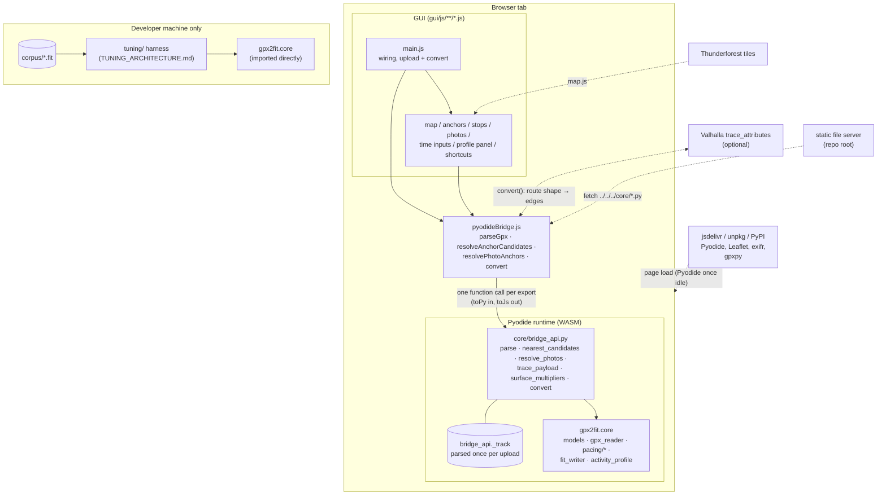

Ownership in short:

- **`appState.js`** holds the app's shared state: the parsed route (points,
  total distance, GPX file name), the chosen sport, and the start time with
  the start-time control's result, from which it derives the activity window.
  `main.js` creates the one instance, writes to it, and hands it to the
  modules that read it.
- **`pyodideBridge.js`** owns the Python runtime and is the only JS file that
  talks to Python. **`core/bridge_api.py`** is the only Python the bridge
  calls, and holds the parsed route.
- **Python** owns every calculation, including distances, nearest-point
  lookups, pacing and encoding. JS never computes a route distance itself.

---

## 4. The data contract: `models.py`

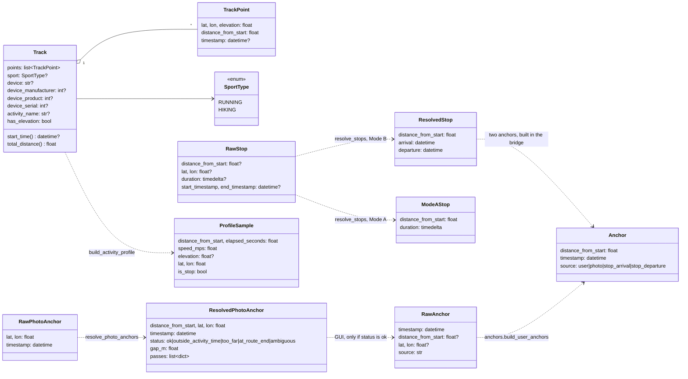

Invariants that the rest of the code relies on:

- `TrackPoint.distance_from_start` is the cumulative **3D** distance
  (gpxpy's `distance_3d`, falling back to 2D when there's no elevation). It
  never decreases. Gradients are therefore rise over slope distance.
- A missing `<ele>`, or one outside −500…9000 m (a writer's "no data"
  sentinel such as −32768), inherits the previous point's elevation. Points
  before the first usable one take that first value. With no usable
  elevation anywhere, every point gets `0.0` and `Track.has_elevation` is
  False, which is what `fit_writer` and `activity_profile` check to leave
  altitude out (a real `0.0` is sea level).
- Climb totals (the FIT's `total_ascent`, the sidebar's Elevation stat) come
  from `gradient.elevation_gain`, which ignores wiggles under 5 m. Summed raw
  point deltas count DEM rounding as climb.
- `timestamp` is `None` from parsing until `combine()` sets it.
- A **stop** is a pair of points at the same distance: the original point
  and a duplicate inserted right after it. The zero-distance leg between
  them is the stop's duration. `combine`, `fit_writer` and
  `activity_profile` all detect a stop with the same test: *a zero-distance
  leg that takes time*.
- Mode A stop: the user gave only a duration, and `combine()` derives the
  arrival from the pacing model. Mode B stop: the user gave explicit arrival
  and departure times, which become two `Anchor`s.

---

## 5. `core/` module by module

### 5.1 Import graph inside `core/`

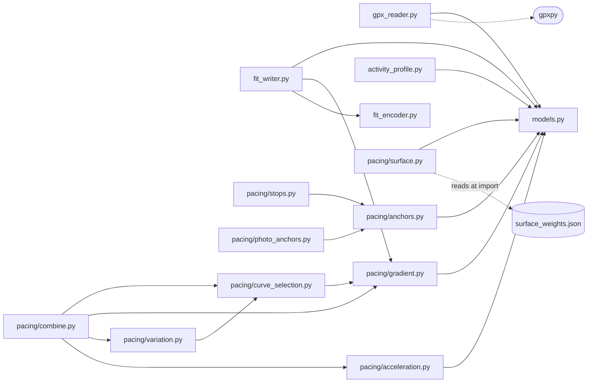

`models.py` also defines `InputError`, a subclass of `ValueError` (see
[§9](#9-errors)).

`combine.py` is the only module that brings the pacing pieces together.
`surface.py` is not imported by `combine`. The bridge calls it and passes
the resulting multipliers to `combine()` as a plain list. `anchors.py`,
`stops.py` and `photo_anchors.py` never call pacing code.

### 5.2 `gpx_reader.py`

```
parse_gpx_bytes(gpx_bytes, device=None, *, max_leg_m=MAX_LEG_M, warnings=None) -> Track
  bytes ─decode utf-8─▶ gpxpy.parse ─▶ for track/segment/point:
      cumulative distance_3d (→ distance_2d) ,
      implausible elevation → missing, carry-forward, leading back-fill,
      join to the previous segment wider than SEGMENT_GAP_WARNING_M (100 m) → noted
  ─▶ densify_points(points, max_leg_m)   (skipped when max_leg_m is None)
  ─▶ Track(points, device = device or <gpx creator>, has_elevation)
  appends to warnings: one message if any segment join was a gap
  raises InputError: not UTF-8 · not GPX · no track points · one point · no length

densify_points(points, max_leg_m) -> list[TrackPoint]
  each leg longer than max_leg_m ─▶ ceil(leg / max_leg_m) equal pieces,
      lat/lon/elevation/distance_from_start interpolated linearly
  the original point objects are kept, unchanged and in order
```

Segments are always concatenated, and a gap is joined with a straight leg
that is paced like the rest. The warning only tells the user it happened.

**Densifying (2026-10-08).** Every leg longer than `MAX_LEG_M` (2 m) is
split into equal pieces on the straight line between its points, since a GPX
says nothing about the path between them. Pacing works per leg. On a sparse
planner GPX (legs of 100 m or more), speed used to step at each point, and
the gradient window and the pace wander had nothing to smooth. Anchors,
photos and stops also snapped up to half a leg away. 2 m (it was 15 m at
first) is short enough for the acceleration limit (§5.9a) to ramp a change
of speed across several legs. The tuning harness densifies the same way. A
dense GPX is left as it is. Because this happens in the parser, every later
step uses the dense track: the map, nearest-point lookups, pacing and the
FIT file. The Valhalla request doesn't: it is thinned back to a point every
15 m (§5.8).

It reads only `<trk>` points. Route (`<rte>`) and waypoint elements are
ignored.

### 5.3 `pacing/anchors.py`: finding points and building anchors

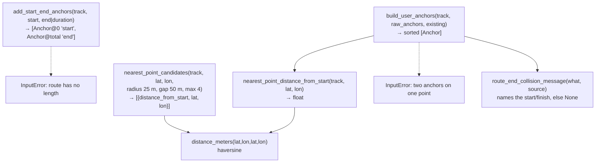

`nearest_point_candidates` is how out-and-back routes are handled. It finds
the closest point, collects every point within 25 m of it, and splits them
into clusters wherever the distance along the route jumps by more than
50 m. Each cluster is one pass of the route, and one representative per
pass is returned. A normal route always returns exactly one candidate.

### 5.4 `pacing/stops.py`

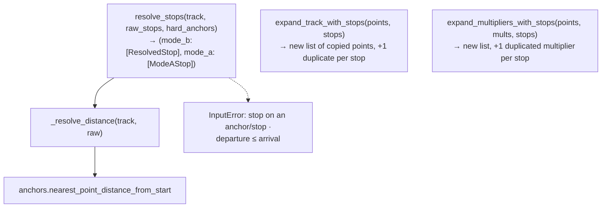

Both `expand_*` functions return new lists. `_track.points` is never
changed, because the bridge reuses `_track` for every conversion: every
point is copied, so `combine()` stamping the working track's timestamps
never reaches `_track`. A stop's distance must equal an existing point's distance
exactly. That's guaranteed because the GUI always sends a distance that
Python itself returned.

### 5.5 `pacing/photo_anchors.py`

```
resolve_photo_anchors(track, raw_photo_anchors, max_match 150 m,
                      activity_start?, activity_end?)
  for each photo:
     nearest_point_candidates → pick the candidate closest to the photo's GPS
     passes = the candidates that aren't a route end
     status = "outside_activity_time"  unless start < capture time < end, no padding  (checked first)
            | "too_far"                if gap > 150 m
            | "at_route_end"           if the match is the first or last point (the start/end anchors sit there)
            | "ambiguous"              if more than one pass: on an out-and-back the passes are metres
                                       apart, so the GPS can't tell; the user picks from `passes`
            | "ok"
  → [ResolvedPhotoAnchor]   (never raises for a bad match; the caller decides)
```

### 5.6 `pacing/gradient.py`: terrain to relative speed

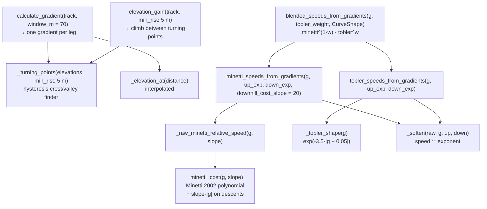

- **Window.** Each leg's gradient is rise over run across a 70 m window
  centred on the leg. Near a detected crest or valley, the window shrinks
  symmetrically so that it ends at the turning point, but not below 30 m.
  Past that limit it slides away from the turning point instead. At the
  track's ends it slides inward at full length.
- **Curves are relative.** Every curve returns 1.0 on flat ground, so every
  blend of them does too. Absolute speed comes later, when `combine` scales
  each segment to its duration.
- **Softening.** `speed ** exponent` scales log-speed linearly. That's why
  `curve_selection` can fit the exponents directly to a log-space bound.
- **Descent cost slope.** `MINETTI_DOWNHILL_COST_SLOPE` sets where Minetti's
  descents turn slower than flat. The app always uses the default; the
  `downhill_cost_slope` argument exists so the tuning harness can fit it.

### 5.7 `pacing/curve_selection.py`: three per-workout decisions

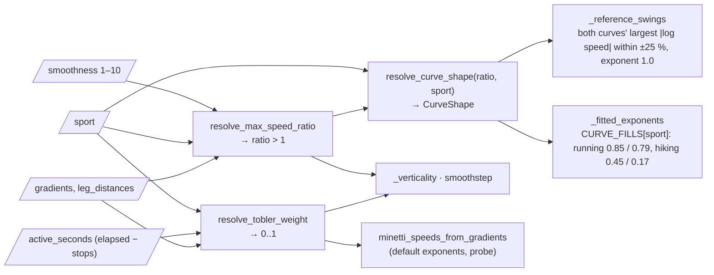

| Decision                                                      | Inputs                                    | How                                                                                                                                                                                                                                                                                                                                                                                                                             |
|---------------------------------------------------------------|-------------------------------------------|---------------------------------------------------------------------------------------------------------------------------------------------------------------------------------------------------------------------------------------------------------------------------------------------------------------------------------------------------------------------------------------------------------------------------------|
| **Tobler weight** (how much walking curve to mix in)          | flat-equivalent speed, verticality, sport | Flat-equivalent speed = `Σ(leg_distance / minetti_speed) / active_seconds`, i.e. the speed with the terrain divided out. Verticality is the distance-weighted mean `                                   \|gradient\|`. Each is ramped through a `smoothstep` band around the sport's `TOBLER_THRESHOLDS`, and the result is the `max()` of the two. Minetti is always the probe curve.                                           |
| **Max speed ratio** (how far a leg may swing from the median) | verticality, sport, smoothness            | Ramps from `MAX_SPEED_RATIO_BOUNDS[sport].flat` to `.hilly` around `HILLY_VERTICALITY` (0.06 ± 0.04), then raised to `SMOOTHNESS_SCALES[level]`. Level 5 leaves it unchanged.                                                                                                                                                                                                                                                   |
| **Curve shape** (exponents for both curves)                   | max speed ratio, sport                    | Exponents are chosen so that each curve's largest log-speed between flat and ±25% grade equals the sport's `CURVE_FILLS` share `× log(ratio)`. For a curve that keeps slowing, that is its value at ±25%; a curve that peaks and turns back is measured at the peak, so crossing flat speed near 25% can't blow the exponent up. The curve and the bound always narrow together, and the soft clamp only has to catch outliers. |

`CURVE_FILLS`, `MAX_SPEED_RATIO_BOUNDS` and `HILLY_VERTICALITY` are fitted by
the tuning harness (2026-09-29). `TOBLER_THRESHOLDS` and the band widths are
still first guesses.

### 5.8 `pacing/surface.py`

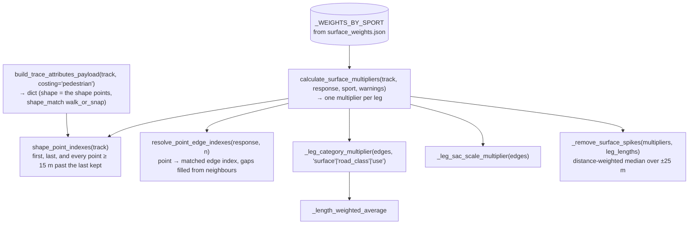

Valhalla gets a thinned shape: `shape_point_indexes` keeps the first and
last points and every point at least `SHAPE_SPACING_M` (15 m) past the
previous one kept. The track is densified to 2 m legs, and a point per leg
would cost a 25 km route ~12,500 shape points (Valhalla's default limit is
16,000) for nothing, since densified points lie on straight lines. Each
multiplier below is worked out per *shape leg* (between two shape points)
and given to every track leg inside it.

For each shape leg: `physical = 0.5·surface + 0.3·use + 0.2·road_class`. If the
leg has a SAC scale, one of two things happens:

- The SAC factor replaces `physical` outright when it's severe (≤ 0.85) and
  within 0.25 of `physical`.
- Otherwise, it's blended in: `0.7·sac + 0.3·physical`.

A leg with no matched edge gets 1.0, and so does a leg whose matched edges
run backwards (a matching glitch; it used to raise and cost the whole route
its surfaces). When those legs add up to `SURFACE_FALLBACK_WARNING_SHARE`
(10%) of the distance or more, a warning is appended.

Last, `_remove_surface_spikes` gives each leg the distance-weighted median
of the multipliers within ±`SURFACE_SPIKE_HALF_WINDOW_M` (25 m). A surface
feature shorter than that (a road crossing, a matching glitch) takes its
surroundings' value; longer ones, and the steps between them, are unchanged.

The HTTP request
itself is made in `pyodideBridge.js`, which also turns a failed request into
a warning (`describeSurfaceFailure`).

### 5.9 `pacing/variation.py`: pace wander on steady stretches

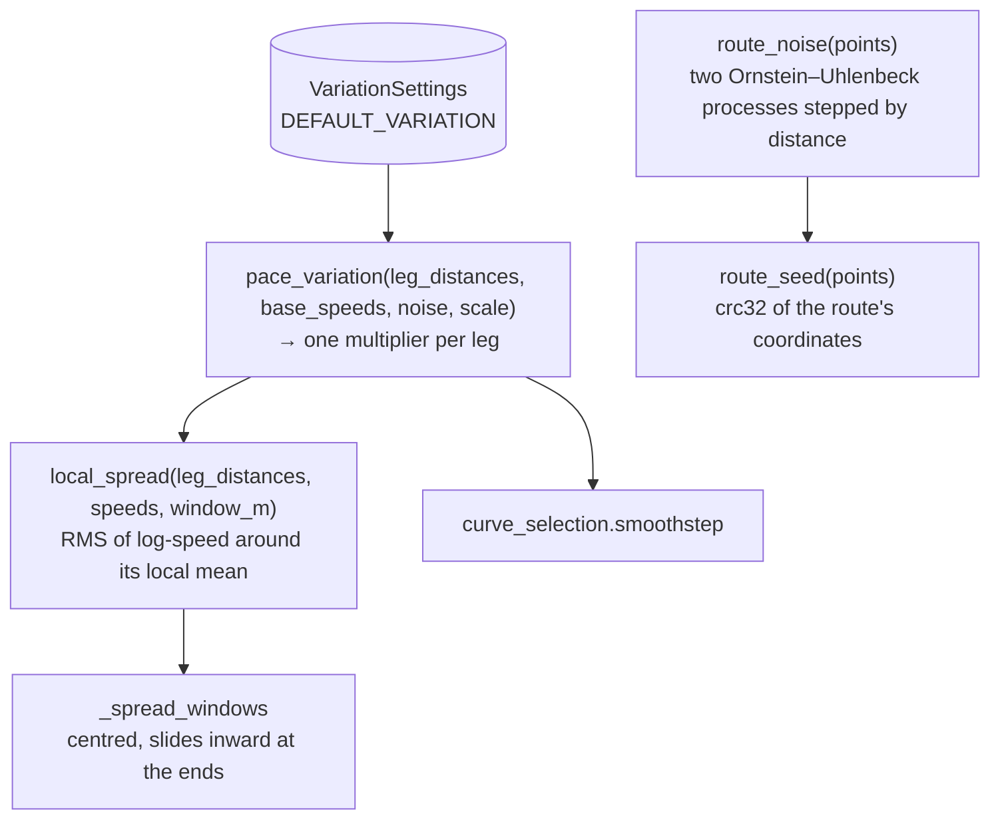

The gradient curves map terrain to speed, so a flat road or an even climb
comes out at one constant speed. `combine()` builds these multipliers once,
over the whole track, from the speeds `_pace_segment` starts from (the
blended curve × surface). The steps:

- `local_spread` measures how much those speeds vary within ±200 m.
- Where they hold one value, a leg gets the full amplitude
  (`sigma`, 0.06 in log-speed). It ramps to none across
  `steady_spread ± steady_band`. Terrain that already varies the pace
  gets no noise.
- `scale` is the smoothness level's `SMOOTHNESS_SCALES` factor, the same
  factor that scales the gradient swing.

The noise is deterministic. It is seeded from the route's coordinates and
stepped by distance. A zero-distance leg (a stop's duplicate point) keeps
its value and draws nothing. So converting again, moving an anchor or adding
a stop never reshuffles it, and its statistics don't depend on how densely
the GPX is sampled.

### 5.9a `pacing/acceleration.py`: no sudden changes of speed

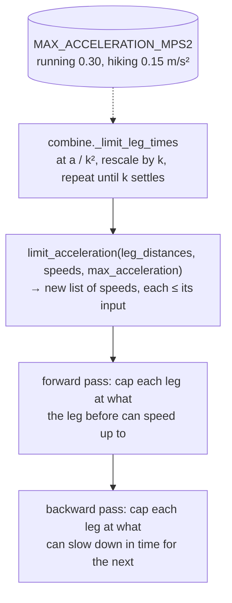

Each leg is paced at one speed, so a surface change, a hilltop or a valley
floor used to be a jump between two 1 Hz records. The limit turns each jump
into a ramp:

- **Constraint.** Between two adjacent moving legs, measured between their
  midpoints: `|v₂² − v₁²| ≤ a · (Δs₁ + Δs₂)`. At constant acceleration v² is
  linear in distance, so this is exact. `a` is the sport's
  `MAX_ACCELERATION_MPS2` (first guesses, about a 3 s transition for a
  typical step).
- **Envelope.** Each modeled speed is a ceiling, the most its terrain
  allows. The result is the fastest profile under every ceiling that keeps
  the limit, found by one forward and one backward pass. Speeding up onto
  faster terrain starts where it begins. Slowing down for slower terrain is
  finished by the time you reach it. A short fast patch peaks lower, and
  only on the patch. A short slow patch is crossed at its own speed. Every
  lowered leg is exactly at the limit against a neighbour, and legs already
  within the limit come back bit for bit.
- **Stops.** There is no constraint across a zero-distance leg, so a stop
  still starts and ends instantly.

### 5.10 `pacing/combine.py`: fitting the model to the anchors

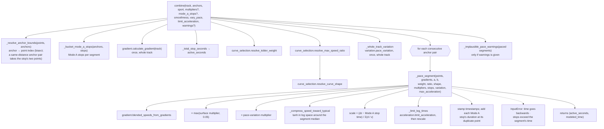

Within one segment, `_pace_segment` does the following, in order:

1. Stamp the first and last points from the two anchors.
2. `v_i` = blended curve speed × surface multiplier × pace-variation
   multiplier (see §5.9; 1.0 wherever the pace already varies).
3. Compress `v_i` toward the segment median with
   `median · exp(L · tanh(ln(v/median) / L))`, where `L = ln(max_ratio)`.
   This is a soft clamp, so it never produces a flat plateau.
4. Modeled time per leg is `d_i / v_i`. Scale all of them so they add up
   to the segment's active time.
5. Unless `limit_acceleration=False`, limit the now absolute speeds to the
   sport's `MAX_ACCELERATION_MPS2` (§5.9a) and rescale the times to the
   active time again. Limiting only slows legs, so the rescale speeds every
   leg up by one factor k ≥ 1, which steepens each ramp by k². So the limit
   is applied at `a / k²`, with k found by fixed-point iteration from 1
   (a few rounds on a real route). Each segment is limited on its own, so
   the step at an anchor stays.
6. Walk the legs, adding the time. When the walk crosses a Mode A stop's
   zero-distance leg, add the stop's duration to that point and every later
   point.

Gradients and the pace variation are computed once for the whole track and
then sliced per segment, so neither is cut off at an anchor.

Each segment is scaled on its own, so a misplaced anchor shows as a step in
pace. That is inherent, so instead of smoothing it away `combine()` reports
it. `modeled_time` is in flat-equivalent metres (the curves are 1.0 on the
flat), which makes `active_seconds / modeled_time` a terrain-adjusted pace:
- A segment of at least `PLAUSIBILITY_MIN_SEGMENT_M` (300 m) whose
  terrain-adjusted pace is more than `IMPLAUSIBLE_PACE_RATIO` (2.5×) faster or
  slower than the workout's (Σactive / Σmodeled) gets a warning naming its
  two anchors. A slow climb doesn't count, since the terrain is divided out.
- Two adjacent segments flagged in opposite directions get one warning,
  naming just the anchor between them: that is the time to check.
- The warning never changes the pacing.
`tests/tuning/test_model_mirror.py` pins this function's exact output. See
[§10](#10-the-tuning-harness).

### 5.11 `fit_writer.py`

```
write_fit(track, *, resample=True, record_interval_s=None) -> bytes
  _build_content(track) -> _FitContent      every value decided here
    validate: every point has a timestamp, end > start
    spans = _resample(points, interval_s)  whole-second grid, RECORD_INTERVAL_S[sport] apart, split at stops
          | _per_point(points)        resample=False: one sample per point (tuning tests only)
  _encode(content) -> bytes                 fit_encoder.FitEncoder
    file_id (manufacturer/product = track.device_manufacturer/_product, or DEVELOPMENT/0 when None;
             serial only if track.device_serial; product_name = track.device)
    sport (RUNNING | WALKING for hiking)
    event START
    per span: [event STOP_ALL + START between spans]  add_many(record: ts, lat, lon, alt if has_elevation, distance, speed)
    event STOP_ALL
    lap + session (elapsed, timer = elapsed − paused, distance, ascent = elevation_gain, avg/max speed)
    activity
    → FitEncoder.to_bytes()
```

Records are on a grid of whole seconds, `RECORD_INTERVAL_S[sport]` apart
(running 2 s, hiking 3 s, running's when the track has no sport), because FIT timestamps are whole seconds: a record per point would give a dense GPX several records on one second (a
distance jump in no time) and a sparse one records 30+ s apart. Each record
is interpolated in time inside the leg it falls in and carries that leg's
paced speed. A stop splits the track into spans, and nothing is recorded
while stopped. Span ends round to the nearest second and always get a record, even off
the interval; the grid restarts at each span's start. A stop that rounds
to no time isn't a pause. The records, timer events and summaries all use
those rounded times. The timer events are what make Strava count stops as
stopped rather than as slow moving time.

### 5.11a `fit_encoder.py`

```
crc16(data, crc=0) -> int              FIT's CRC-16 (CRC-16/ARC), byte table
file_header(data_size) -> bytes        12 bytes, no header CRC
encode_value(field, value) -> int      round((v + offset) * scale), int() if unscaled; ValueError if out of range
encode_string(value, min_size)         UTF-8 + NUL, zero-padded
FILE_ID, SPORT, EVENT, RECORD, LAP, SESSION, ACTIVITY   MessageSpec: global id + fields in profile order
FitEncoder
  add(spec, values)                    one message; None fields left out
  add_many(spec, names, rows)          records: one definition check, one struct pack per row
  to_bytes()                           header + messages + file CRC
```

It writes exactly the bytes fit_tool's `FitFileBuilder` wrote for the same
messages, since Strava has accepted that layout: every message on local type
0, re-defined whenever the message changes. fit_tool is now only the tests'
oracle (`tests/core/fit_tool_reference.py`). A 7 h hike at 1 Hz takes about
0.19 s in Pyodide, against about 10 s with fit_tool.

### 5.12 `activity_profile.py`

```
build_activity_profile(track, max_samples=1000) -> [ProfileSample]
  bucket legs by ~total_distance/1000 m → one sample per bucket (true distance/time speed)
  a stop leg closes the bucket and emits two zero-speed samples (arrival, departure, is_stop=True)
```

The chart in the GUI only handles presentation. All the reduction happens
here, in Python.

---

## 6. The bridge: `pyodideBridge.js` and `core/bridge_api.py`

`pyodideBridge.js` is the only JS file that talks to Python, and every
call it makes goes to one function in `core/bridge_api.py`. That module
holds all the Python orchestration (building dataclasses from the GUI's
dicts, merging anchors and stops, the pipeline in [§8.3](#83-inside-convert)),
so pytest and pyrefly cover it like any other `core/` module
(`tests/core/test_bridge_api.py`). It takes and returns plain dicts, lists,
numbers, strings and bytes. Its dict keys are the GUI's camelCase, except a
nearest-point candidate's, which is `nearest_point_candidates`' own dict.

| Export                              | `bridge_api` call                                      | Returns                                                   |
|-------------------------------------|--------------------------------------------------------|-----------------------------------------------------------|
| `parseGpx(bytes)`                   | `parse(bytes)`, which keeps the route as `_track`      | `{points, summary, warnings}` for the map and sidebar     |
| `resolveAnchorCandidates(lat, lon)` | `nearest_candidates(lat, lon)`                         | 1–4 candidates                                            |
| `resolvePhotoAnchors(readings)`     | `resolve_photos(readings)`, with no activity window    | status per photo                                          |
| `convert({...})`                    | `trace_payload`, `surface_multipliers`, then `convert` | `{fitBytes, profile, warnings}`                           |
| `warmUpPyodide()`                   | none                                                   | starts loading the runtime once the page is idle          |
| `classifyPyError(err)`              | none                                                   | tags `InputError`s ([§9](#9-errors))                      |
| `describeSurfaceFailure(err)`       | none                                                   | the warning for a failed surface lookup ([§9](#9-errors)) |

Four mechanisms keep the bridge working:

1. **Startup (`ensurePyodide`).** `main.js` calls `warmUpPyodide()` on
   page load, which starts this once the page is idle (`requestIdleCallback`,
   skipped when the browser asks to save data), so the first upload rarely
   waits. Otherwise the first call does it. The setup:
   - add Pyodide's `<script>` from jsdelivr, pinned by `PYODIDE_VERSION`
     (the only place the version is written; `index.html` has no tag for it)
   - `micropip.install` `gpxpy`, pinned to the `uv.lock` version
     (`GPXPY_VERSION`)
   - fetch every file in `CORE_FILES` over HTTP from `../../../core/`, resolved
     against the bridge module's own URL (`import.meta.url`), so the site
     works whether the repo root or `src/gpx2fit/` is served
   - write them into `/workspace/src` in Pyodide's virtual filesystem
     (`FS.writeFile`), prepend that directory to `sys.path`, and
     `pyimport` `gpx2fit.core.bridge_api`

   A failed load (offline, a CDN hiccup) is forgotten, and a script tag that
   failed is removed, so the next call tries again.
   **A `core/` file that isn't in `CORE_FILES` doesn't exist in the
   browser**, and nothing warns about it until an import fails there.
2. **Plain values across, no proxies left behind (`callBridge`).** An
   object or array argument goes over with `pyodide.toPy` (a `Uint8Array`
   arrives as a memoryview, `undefined` as `None`), and the result comes
   back with `toJs` (dicts as plain objects, `bytes` as a `Uint8Array`).
   The argument proxies, the function proxy and the result proxy are all
   destroyed before the call returns, so no conversion's data stays alive in
   Python. Only the parsed route does, in `bridge_api._track`, so a GPX file
   is parsed once and reused for clicks, photos and every conversion.
3. **Serial queue (`enqueue`).** Calls are chained on one promise.
   `convert` awaits the Valhalla request between `trace_payload` and
   `convert`, and a parse landing in that gap would swap the route under
   it. A failed call rejects only for its own caller, and the next call in
   the queue still runs. `fetchSurfaceMultipliers` isn't exported and isn't
   queued, because it runs inside `convert`'s queued task. Queueing it
   again would deadlock.
4. **Errors are classified once, in `enqueue`** ([§9](#9-errors)).

---

## 7. The GUI

### 7.1 Module dependency graph

```mermaid
flowchart TD
  main["main.js<br/>entry, wiring, upload + convert handlers"]
  as["appState.js<br/>route, sport, start time, activity window"]
  stt["status.js<br/>the status line"]
  set["settings.js<br/>surface + smoothness, remembered"]
  bridge["pyodideBridge.js"]
  map["map.js<br/>Leaflet map, route, pin layers,<br/>hover marker, the desktop popup"]
  ph["popoverHost.js<br/>Leaflet popup or the phone's #routeDialog"]
  ap["anchorPopovers.js<br/>route-click flow: anchor-or-stop →<br/>anchor time popover,<br/>placePhoto card for a location-less photo,<br/>choosePhotoPass for an ambiguous one,<br/>confirm a dragged photo pin's move"]
  sp["stopPopover.js<br/>duration or arrival + departure"]
  cp["candidatePicker.js<br/>Which pass?"]
  tc["timeChecks.js<br/>inside start–end and in time order?"]
  pe["placementEstimates.js<br/>uniform-pace estimate, time pre-fill"]
  ppart["popoverParts.js<br/>heading, hint, buttons, photo header"]
  ppl["photoPlacement.js<br/>pending photo, likely pass by photo time"]
  ao["anchorOrder.js<br/>is a point in time order?"]
  anchors["anchors.js<br/>createAnchorList"]
  stops["stops.js<br/>createStopList + change listener"]
  ml["markerList.js<br/>shared list+pin bookkeeping, pins injected"]
  aw["activityWindow.js<br/>is an anchor/stop inside start–end?"]
  photo["photoAnchors.js<br/>createPhotoDrop: EXIF via exifr → resolve → addAnchor"]
  ti["timeInput.js<br/>createTimeToggle (duration / end / avg speed)"]
  se["speedEntry.js<br/>avg-speed boxes, unit, quick-picks"]
  dtf["dateTimeField.js<br/>custom date + time fields, segment linking"]
  pp["profilePanel.js<br/>createProfilePanel: slide-up panel, toggles"]
  pc["profileChart.js<br/>SVG chart"]
  mob["mobileLayout.js<br/>phone scroll sheet"]
  sc["shortcuts.js<br/>global keys + ? panel"]
  dp["devicePicker.js<br/>device button + &lt;dialog&gt;"]
  dev["devices.js<br/>catalog, validation, storage"]
  th["theme.js<br/>light/dark"]
  gl["glass.js<br/>liquid-glass refraction switch"]
  rf["rangeFill.js<br/>smoothness slider's center-biased fill"]
  fmt["format.js<br/>formatting + describeError"]
  cfg["config.js<br/>Thunderforest key (gitignored)"]
  subgraph shared["shared UI helpers"]
    seg["segmented.js<br/>radio groups and tabs"]
    fd["focusDropdown.js<br/>quick-pick lists"]
    num["numericInput.js<br/>digits-only boxes, Up/Down"]
    dz["dropzone.js<br/>drop + click-to-browse"]
    dates["dates.js<br/>calendar-day arithmetic"]
    st["storage.js<br/>remembered settings"]
    css["cssVars.js<br/>theme colour tokens"]
  end

  main --> bridge
  main --> map
  main --> as
  main --> stt
  main --> set
  as --> aw
  set --> st
  set --> rf
  main --> ti
  main --> dtf
  main --> anchors
  main --> stops
  main --> ap
  main --> photo
  main --> pp
  main --> sc
  main --> dp
  dp --> dev
  dp --> num
  dp --> st
  main --> seg
  main --> dz
  main --> th
  main --> gl
  main --> fmt
  main --> mob
  main --> ph
  mob -. "mapModule injected" .-> map
  ph -. "map, isPhoneLayout injected" .-> map
  ml -. "a pin layer (map.createPinLayer)<br/>and revealMap injected" .-> map
  ap -. "appState, anchors, stops, map, popovers,<br/>resolveAnchorCandidates, revealMap,<br/>setStatus injected by main" .-> bridge
  ap -. "popovers injected,<br/>handed on to the stop popover and picker" .-> ph
  ap --> ti
  ap --> sp
  ap --> cp
  ap --> tc
  ap --> pe
  ap --> ppart
  sp --> ti
  sp --> seg
  sp --> pe
  sp --> ppart
  sp --> tc
  cp --> ppl
  cp --> ao
  cp --> ppart
  tc --> aw
  tc --> ao
  pe --> dates
  anchors --> ml
  stops --> ml
  anchors --> aw
  stops --> aw
  ap --> aw
  ap --> ppl
  ap --> ao
  ao --> fmt
  main --> aw
  pp --> pc
  pp --> seg
  photo --> dz
  pp -. "map injected (hover dot)" .-> map
  photo -. "appState, resolvePhotoAnchors, addAnchor,<br/>setStatus injected by main" .-> bridge
  photo -. "placePhoto, cancelPhotoPlacement,<br/>choosePhotoPass injected by main" .-> ap
  anchors -. "drag-end listener<br/>set by main" .-> ap
  ti --> dtf
  ti --> seg
  ti --> se
  ti --> num
  ti --> dates
  se --> fd
  se --> num
  se --> dtf
  dtf --> fd
  dtf --> dates
  th -. "onChange: map.setTheme, set by main" .-> map
  th --> st
  th --> css
  map --> css
  map --> cfg
  pc --> fmt
  photo --> fmt
  ti --> fmt
```

`anchorPopovers.js` and `photoAnchors.js` follow one rule: pure helpers
(formatting, the time controls, the order and window rules) are imported,
and everything with state or side effects is passed in by `main.js`.
`createAnchorPlacer` receives `appState`, the `anchors` and `stops` lists,
`map` (only for the placement mode), `popovers`, `resolveAnchorCandidates`,
`revealMap` and `setStatus`, so its tests pass in fakes, including a
`popovers.open` that builds into a plain `<div>`. It hands what the stop
popover and the pass picker need (`popovers`, `appState`, `stops`, its
`createTimeChecks` and its estimate) on to `openStopPopover` and
`openCandidatePicker` when it opens them.
`photoAnchors.js` receives `appState`, `resolvePhotoAnchors`, `addAnchor`,
`placePhoto`, `cancelPhotoPlacement`, `choosePhotoPass` and `setStatus`, so
its tests pass in fakes (and a real `createAppState()`). Every photo anchor, GPS-matched or placed by hand, is
added there, with its `thumbnailUrl` and an `onRemove` hook
(`markerList.add(fields, { onRemove })`) that drops the photo when the
anchor is deleted from the anchor list. A photo that became an anchor is
listed only there; the Photos list keeps the ones that still need the user. `main.js` also hands
`anchorPlacer.handleAnchorDrag` to `anchors.setAnchorDragEndListener`, so a
dropped photo pin goes through the same confirm flow.

The same rule holds below them (since 2026-10-12): no module but `main.js`
imports `map.js`, and `map.js` imports only `config.js` and `cssVars.js`.
- **Lists.** `createAnchorList`/`createStopList` each get their own pin layer
  (`map.createPinLayer()`) and `revealMap`, and hand both to
  `createMarkerList`. A pin layer is the list's `PinLayer`: add, move,
  remove, renumber, panTo, highlight, setDimmed, all by the list's own ids.
  Each list has its own id space, so stops no longer need an id offset, and
  the list tests pass a fake layer instead of mocking `map.js`.
- **Popovers.** `createPopoverHost({map, dialogEl, isPhoneLayout})` opens the
  content in `map.openPopup` on a desktop and in `#routeDialog` on a phone.
- **Theme.** `initTheme(button, {onChange})` gets `map.setTheme`, which swaps
  the tiles and recolors the route.
- **Panel and photos.** `createProfilePanel({..., map})` uses only the hover
  dot. `createPhotoDrop` and `createProfilePanel` are factories with their
  state inside, so `main.js` holds the one instance of each and calls its
  `reset()`/`hide()` on a new GPX.
- `mobileLayout.js` still receives `mapModule` to move the attribution.

### 7.2 Who owns which state

| State                                              | Owner                                                                                           | Read by                                                                                                                      |
|----------------------------------------------------|-------------------------------------------------------------------------------------------------|------------------------------------------------------------------------------------------------------------------------------|
| route points, total distance, GPX file name, sport | `appState` (`setRoute` once a parse succeeds, `setSport`)                                       | convert handler, `anchorPopovers`, `photoAnchors`; `timeInput` through `speedMode` getters                                   |
| start date/time (as typed)                         | `dateTimeField` instance in `main.js`                                                           | `main.js`'s `getStartTime()`, for the toggle while it works out its result                                                   |
| start time + duration / end / avg-speed result     | `appState.setTime(start, result)`, from `startTimeToggle`'s `onChange`                          | `appState.startTime`/`timeResult`/`activityWindow()`/`durationSeconds()`; `getResult()` again at convert time               |
| anchors                                            | `createAnchorList` in `main.js`, backed by `markerList`                                         | `getActiveAnchors()` at convert time                                                                                         |
| stops                                              | `createStopList` in `main.js`, backed by `markerList`                                           | `getActiveStops()` at convert time; `getStops()` for the avg-speed stop total; the change listener refreshes the time toggle |
| activity window (start–end)                        | derived by `appState`; `onWindowChange` pushes it into the anchor and stop lists → `markerList` | `markerList`'s `isActive` check, `getActive()` and the row text                                                              |
| parsed `Track`                                     | `bridge_api._track` (Python module state)                                                       | every bridge call                                                                                                            |
| theme, surface toggle, smoothness, device          | `localStorage`, through `storage.js`                                                             | `theme.js`, `settings.js`, `devicePicker.js`                                                                                  |

`main.js` calls `startTimeToggle.refresh()` whenever the average-speed
duration could change: after a GPX parses, on a sport change, and on any
stop change. The convert handler calls `getResult()` again rather than
trusting the cached value.

Every time that toggle reports (including after a start-time edit),
`main.js` records it with `appState.setTime(start, result)`: the start and
its result are stored together, so the window never pairs a new start with
an old end. If the window changed (`sameWindow` says otherwise), `appState`'s
`onWindowChange` listener, registered by `main.js`, pushes it into
`anchors.setActivityWindow` and `stops.setActivityWindow`, which hand it to
their `markerList`. The list re-checks every item with its `isActive`
predicate (`activityWindow.js`'s `isAnchorActive`/`isStopActive`: strictly
inside, the same rule as Python's photo check) and re-renders the rows
without renumbering the pins, since a time change can't reorder them.
Photo anchors are included: a photo outside the window at drop time is
still added (see "Dropping photos" below), so this re-check can bring it back. An item outside is kept but marked `.is-inactive`, its pin is dimmed
(its pin layer's `setDimmed`), and it is left out of `getActive*()`. Moving the
window back makes it active again. The convert status then reports how
many were left out (`format.leftOutNote`). An anchor or stop time entered
as "Duration since start" is stored with its offset (`offsetSeconds`, or
`arrival`/`departureOffsetSeconds`), so it follows the start instead of
staying at a fixed clock time. `totalStopSeconds` counts every stop, active
or not: whether a stop is active depends on the end time, which in
avg-speed mode depends on that total.

### 7.3 Interaction flows

Clicking the route:

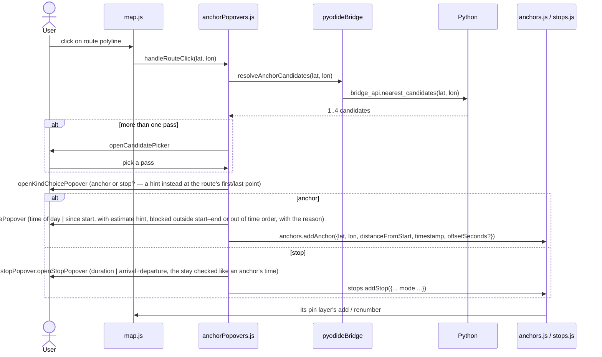

Dropping photos:

```
photoAnchors.handleFiles            (drop, the main input = file chooser, or the gallery input)
  guard: a route is loaded
  readFile: isLikelyPhotoFile (image/*, or an untyped photo extension) → readPhotoMetadata(file)
    → exifr: {lat, lon, timestamp}, either half possibly null; plus the EXIF thumbnail for the row
    no time                → row message only ("No capture time")
    time but no GPS        → row with "Place on map" → anchorPopovers.placePhoto({timestamp, thumbnailUrl, onPlaced, onCancel})
                             map: banner + crosshair + pulsing route (photoPlacement onChange → map.setPlacementMode)
                             next route tap → (candidate picker, the photo's likely pass marked: suggestCandidate)
                             a point out of time order (anchorOrder.findOrderConflict) → a notice, still armed;
                             in the picker such a pass is disabled with the reason
                             → "Place photo here" card (time shown, not editable; outside start–end is allowed, dimmed)
                             confirm → onPlaced({lat, lon, distanceFromStart}) → addAnchor({..., source: 'photo', thumbnailUrl}, {onRemove})
  resolvePhotoAnchors(readings)     (photos with both; one batch, one bridge call, GPS only: no activity window)
  same capture time and place as a live photo → row message only (checked before matching)
  per result: ok → addAnchor({..., source: 'photo', thumbnailUrl}) · too_far / at_route_end → row message only
              ambiguous → row with "Resolve" → anchorPopovers.choosePhotoPass({timestamp, thumbnailUrl, passes, onPicked})
                          → "Which pass?" picker (likely pass marked, out-of-order passes disabled)
                          → onPicked(pass) → addAnchor (skipped if the row was removed meanwhile)
  became an anchor → row leaves the Photos list, counted by #photoSummary; the anchor list shows it
  ok but outside the current start–end → still added; one batch status says it's not used yet
  afterwards: a start/duration change re-checks the photo anchor like any other (anchors.setActivityWindow)
  anchor deleted from the anchor list → its onRemove → the photo is dropped, its thumbnail freed
  row removed (×, or a reset for a new GPX) while reading/matching → its photo is never matched or added
```

Moving a photo pin:

```
pins.add(..., {draggable})          (the anchor list's pin layer; markerList's isDraggable: anchors.js says source === 'photo')
  drag     → the pin snaps to the drawn route (L.Polyline#closestLayerPoint)
  dragend  → markerList → anchors.setAnchorDragEndListener → anchorPopovers.handleAnchorDrag(anchor, lat, lon, revert)
             resolveAnchorCandidates → (candidate picker, likely pass marked) → "Move photo?" card
             out of time order with another active anchor or stop → revert() and a notice saying which, and where to go
             Move → anchors.moveAnchor → markerList.move (re-sort, renumber) → pins.move
             anything else (Keep, ×, click elsewhere, Esc, start/finish, same point) → revert()
```

### 7.4 Smaller modules

- **`appState.js`**: `createAppState({sport})`. Plain getters (`route`,
  `sport`, `startTime`, `timeResult`), one setter each (`setRoute`,
  `setSport`, `setTime(start, result)`), the derived `activityWindow()` and
  `durationSeconds()`, and `onWindowChange(fn)`, which fires only when the
  window really moved. Tested.
- **`status.js`**: `createStatus(statusEl)` returns `setStatus(message,
  kind)`. An `'error'` or `'input'` status goes back to "Ready." after
  `STATUS_ERROR_TIMEOUT_MS`; a `'warning'` stays. Tested with mocked timers.
- **`settings.js`**: `initSurfaceLookupSetting(checkbox)` and
  `initSmoothnessSetting(slider, valueEl)` restore and store the two
  remembered conversion settings (`surfaceLookup`, `smoothness`). Tested.
- **`timeInput.js`**: `createTimeToggle({variant, speedMode?})`.
  - Variants are `durationOrEnd` (the main control), `durationOrTimeOfDay`
    (the anchor popover) and `durationOnly` (a stop's duration).
  - Every mode resolves to `{isValid, mode, resolvedDate, durationSeconds}`.
  - Average-speed mode computes
    `duration = distance / speed + total stop time` in JS. Its boxes are
    **`speedEntry.js`**'s `createSpeedEntry({getSport, onInput})` (km/h or
    min:sec, the unit button, the quick-picks), which only reads a speed.
  - `focusMode(mode)` and `nextMode()` open a tab and focus its first box,
    for the shortcuts. Tested, as is `speedEntry`.
- **Placement helpers** (`placement/`), around `anchorPopovers.js`:
  - `stopPopover.js`: `openStopPopover(candidate, deps)`.
  - `candidatePicker.js`: `openCandidatePicker({popovers, candidates,
    estimateArrival, onPick, photoTime?, conflicts?, onDismiss?})`.
  - `timeChecks.js`: `createTimeChecks({appState, anchors, stops})` returns
    `isInsideWindow`, `typedTimeProblem(distance, time, until?)` (the
    message under a typed anchor or stop time, or null) and
    `photoOrderConflict`.
  - `placementEstimates.js` (pure, tested): `estimateArrivalDate`,
    `isRouteEnd`, `toggleDefaultsFromEstimate`, `offsetSecondsOf`.
  - `popoverParts.js` (tested): `popoverHeading`, `popoverHint`,
    `estimateHint`, `confirmButton`, `optionButton`, `cardActions`,
    `photoSummary`.
  - `popoverHost.js` (tested): `createPopoverHost({map, dialogEl,
    isPhoneLayout})` returns `open(lat, lon, build, {onClose})`. On a
    desktop that is `map.openPopup`. On a phone the content goes in the
    `#routeDialog` modal instead (a popup above the sheet has no room). The
    builders get the same `(container, close, updateLayout)` either way, and
    an optional `onClose` runs once however the content goes (its `close()`,
    the ×, the backdrop, Esc, or new content replacing it). The dialog's
    `close` event arrives a task late, after a builder that closed itself to
    open the next step has reopened the dialog. So the host ends the previous
    content itself, and ignores a `close` event while the dialog is open
    again. Tested against a dialog stand-in, since jsdom has no `showModal`.
- **`anchorOrder.js`** (pure, tested): `timedPoints`, `findOrderConflict`
  (a stop's span via `until`), and the messages: `describeOrderConflict`
  (where to put a photo), `describeTimeConflict` (which way to change a
  typed time) and `describeOrderConflictBriefly` (a disabled pass).
- **`dateTimeField.js`**: custom date and time fields with quick-pick
  dropdowns. `linkSegmentPair` makes the arrow keys move between the
  hours and minutes boxes.
- **Shared UI helpers**, each tested:
  - `segmented.js`: `wireSegmented(control, onSelect, {kind})` for the
    controls in `index.html` (sport, chart unit and axis) and
    `createSegmented` for the ones built at runtime (start-time modes, the
    stop popover's modes). It owns the ARIA: `kind: 'radio'` (default) is a
    radio group, `'tabs'` a tab list whose `linkPanel(value, panel)` ties
    each tab to its panel. Both take the arrows, Home and End.
  - `focusDropdown.js`: `createFocusDropdown`, the list under the time
    fields, the speed presets and the day selector. It opens on focus (or a
    click), fills on a click and closes once focus leaves.
  - `numericInput.js`: `wireNumericBox` and `createNumericInput`, text
    boxes with digits-only entry and Up/Down stepping (see CLAUDE.md for why
    they aren't `type="number"`).
  - `dropzone.js`: `wireDropzone`/`wireFileInput` for the GPX and photo
    dropzones.
  - `dates.js`: `dayOffsetBetween`, `computeDayCount`, `toDateInputValue`.
  - `storage.js`: `readSetting`/`writeSetting`, which never throw.
  - `cssVars.js`: `readCssVar` and `accentColor`, for what CSS can't style
    (Leaflet's route line and hover dot, the toolbar's theme-color).
- **`shortcuts.js`**: each entry in one `SHORTCUTS` array binds a key,
  renders a row in the "?" panel, carries its own `run(controls)` and lists
  the controls it advertises `aria-keyshortcuts` on (`targets`). Each run
  calls `.click()` on the existing control, or the start-time controls' own
  focus methods. Besides the sport, convert, file and device keys, Alt+N
  focuses the start date (`startTimeField.focus()`), Alt+L the duration
  (`startTimeToggle.focusMode('duration')`), Alt+K steps through the
  start-time tabs (`nextMode()`), and Alt+G hides or reopens the profile.
  `main.js` passes the wired sport control (`wireSegmented`'s handle), the
  start-time field and toggle, `appShellEl` and the profile's close/show
  buttons, so it reads no other module's markup.
- **`glass.js`**: `supportsBackdropRefraction(nav)` (true when
  `userAgentData` lists Chromium) and `initGlass()`, which sets
  `html.glass-refraction`. That turns on `index.html`'s `#liquidGlass` SVG
  filter in the floating panes' `backdrop-filter`. Tested.
- **`rangeFill.js`**: `centerBiasedFill(value, min, max, origin)` (pure) and
  `initCenterBiasedRange(input, origin)`, which keeps `--range-lo`/`--range-hi`
  on the smoothness slider so its fill grows from 5 (automatic) toward the
  knob, as in macOS 26's center-biased slider. Tested.
- **`devices.js`**: `DEVICE_CATALOG` (brand → `{name, manufacturer, product}`;
  only IDs with a real source: Garmin from the FIT SDK profile (`fit_tool`'s
  `GarminProduct`, and Garmin's `fit-javascript-sdk` for the newest), Suunto
  from its own product-ID list, other brands from a recording Strava named or
  another FIT reader's device table: GoldenCheetah, Runalyze) plus pure helpers
  (`selectionLabel`, `parseCustomIds`, `parseStoredSelection`,
  `toConvertDevice`). Tested.
- **`devicePicker.js`**: the sidebar's device button and the native
  `<dialog>` it opens with `showModal()`. Persists the choice in
  `localStorage` (`device`). Nothing is focused on open; the first Tab goes
  to the current pick, and the arrows then move over the grid through the
  exported pure `moveFocusIndex(rowLengths, index, key)`, which is tested.
  jsdom has no `showModal`, so the rest of the module is untested.
- **`theme.js`**: `initTheme(button, {onChange})` picks the stored theme, or
  the system's, sets `data-theme`, the button's icon and the toolbar tint,
  then calls `onChange(theme)`; `main.js` passes `map.setTheme`. Tested.
- **`profilePanel.js`**: `createProfilePanel({...elements, map})` returns
  `show(samples, sport)` and `hide()`. It opens two animation frames after
  `show`, defaults the unit to the sport until the user picks one, and never
  lets the last series be hidden. Tested with the real chart.
- **`profileChart.js`**: pure helpers (`niceTicks`, `linearScale`,
  `buildSeries`, `stopRuns`, `averageMovingSpeedMps`, `linePath`, …) plus
  `createProfileChart`. The pure part has tests.
- **`format.js`**: every formatter, plus `describeError(err) →
  {message, kind: 'input'|'error'}`.
- **`mobileLayout.js`**: the phone layout (`PHONE_LAYOUT_QUERY`, ≤ 860 px,
  kept in step with `css/responsive.css`). The CSS fixes the map full-screen behind
  the sidebar, which becomes a sheet in the page's scroll. The module:
  - opens the page with the sheet half-way up
  - moves `#profilePanel` and `#profileShowButton` to the top of the sheet,
    and moves the Leaflet attribution to the top right
  - `coveredMapHeight()` tells `map.js` how much of the map the sheet hides,
    via `setBottomInsetProvider`. `renderRoute` and a pin layer's `panTo`
    then aim at the visible part.
  - `revealMap()` scrolls the sheet back to half-way. It runs after a GPX
    parses and when an anchor or stop row is clicked.
  - `isPhoneLayout()` tells the popover host where to open (see
    `popoverHost.js` above).

  The layout logic is tested against a stubbed `matchMedia`.

---

## 8. End-to-end code flow

### 8.1 Timeline of one session

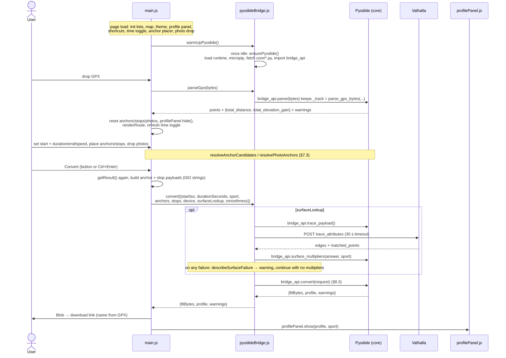

### 8.2 Data flow

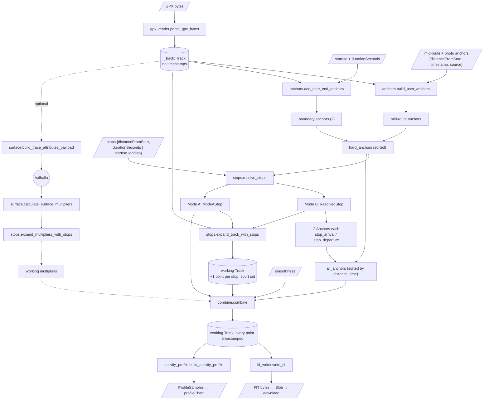

### 8.3 Inside `convert()`

This is the order `bridge_api.convert(request)` runs in. It first turns
the request's dicts and ISO strings into dataclasses, and the sport name
(`"running"`/`"hiking"`, the GUI's own) into a `SportType`. `combine`
appends to a fresh `warnings` list per call, and the JS side puts the
surface lookup's warnings (from `bridge_api.surface_multipliers`, or
`describeSurfaceFailure`) ahead of them.

1. `boundary = add_start_end_anchors(_track, start, duration=…)`
2. `mid_route = build_user_anchors(_track, raw_anchors, existing_anchors=boundary)`.
   The GUI always sends `distanceFromStart`, so no lat/lon lookup happens
   here.
3. `hard_anchors = sorted(boundary + mid_route)`
4. `resolved_mode_b, mode_a_stops = resolve_stops(_track, raw_stops, hard_anchors)`
5. `all_anchors = sorted(hard_anchors + stop_arrival/departure anchors)`
6. `working_track = Track(expand_track_with_stops(_track.points, all_stops), sport, device, name, has_elevation)`,
   where `device` is the request's `device.name` or `_track.device`, plus the three device IDs.
   They go on the working track, never on `_track`, so clearing the device
   between two conversions of one route really clears it
7. `working_multipliers = expand_multipliers_with_stops(...)` (if the
   request carries `surfaceMultipliers`)
8. `combine(working_track, all_anchors, sport, working_multipliers, mode_a_stops, smoothness, warnings=warnings)`
9. `write_fit(working_track)` → `fitBytes`
10. `build_activity_profile(working_track)`, converted to camelCase dicts
    → `profile`

Surface multipliers are computed against `_track` (not yet expanded), and
only then expanded to match `working_track`. Every conversion builds a fresh
working track, so the same `_track` can be converted any number of times.

---

## 9. Errors

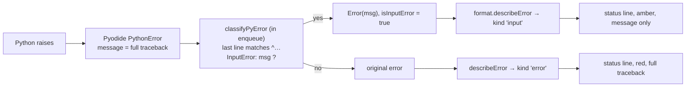

| Raise                         | When                                                                                                                                                                                                                                                                   |
|-------------------------------|------------------------------------------------------------------------------------------------------------------------------------------------------------------------------------------------------------------------------------------------------------------------|
| `InputError`                  | The user can fix it: corrupt GPX, two anchors on one point, a stop on an anchor, departure ≤ arrival, anchor times out of order with distance, stops longer than their segment. Write the message for the user: plain words, real km and times, and a hint at the fix. |
| `ValueError` / `RuntimeError` | A broken internal contract, i.e. a bug between the GUI and `core/`. The traceback is shown so it can be debugged.                                                                                                                                                      |

`combine._describe_anchor` formats an anchor for these messages, for
example "photo anchor at 5.30 km (2026-09-13 14:02)".

**Warnings** are the third channel: the conversion went through, but maybe
not as the user meant. Same writing rules as an `InputError` message.
- `parse_gpx_bytes`, `calculate_surface_multipliers` and `combine` take an
  optional keyword `warnings: list[str]` and append to it. Their return
  values don't change, so callers that don't care (tests, the tuning
  harness) pass nothing.
- `bridge_api` returns them as `warnings` from `parse`,
  `surface_multipliers` and `convert`, and the bridge from `parseGpx` and
  `convert`. `convert` puts the surface lookup's first: Python's, or the
  JS side's own when the lookup failed (`describeSurfaceFailure`: a
  timeout, an HTTP error with Valhalla's own `error` text, no network, or an
  answer Python couldn't use).
- `format.statusWithWarnings` appends them to the success message as kind
  `'warning'`: amber (`.status-warning`) and, unlike `'input'`/`'error'`,
  not cleared on a timer.

| Warning                  | From                                                    |
|--------------------------|---------------------------------------------------------|
| Gap between segments     | `gpx_reader` (a join wider than 100 m)                  |
| Surface lookup failed    | the bridge (the request failed outright)                |
| Surface partly unmatched | `surface` (≥ 10% of the distance on the default 1.0)    |
| Implausible pace         | `combine` (a segment ≥ 300 m off by more than 2.5×)     |

---

## 10. The tuning harness

`tuning/` calibrates the pacing constants against real recorded activities.
It's development tooling that runs only on a developer's machine, and it's
documented separately in [TUNING_ARCHITECTURE.md](TUNING_ARCHITECTURE.md).

It touches the app in exactly three places:

- It imports `core/` directly (`gpx_reader`, `gradient`, `curve_selection`,
  `combine`, `anchors`, `models`) and never modifies it. Nothing from
  `tuning/` goes in `CORE_FILES`.
- `tuning/model.py` restates `combine._pace_segment` with the constants as
  arguments. `tests/tuning/test_model_mirror.py` asserts the two produce
  identical timestamps, so a change to `_pace_segment` or the resolvers in
  `curve_selection.py` means updating the mirror.
- What it proposes are new values for constants in `curve_selection.py`,
  applied by hand.

---

## 11. Tests

| Suite           | Location                            | Covers                                                                                                                                                                                                                                                                                                                                                                                                                                                |
|-----------------|-------------------------------------|-------------------------------------------------------------------------------------------------------------------------------------------------------------------------------------------------------------------------------------------------------------------------------------------------------------------------------------------------------------------------------------------------------------------------------------------------------|
| pytest, `core/` | `tests/core/`, `tests/core/pacing/` | every `core` module, including `bridge_api` (`test_bridge_api.py`: each call's result shape and the route kept between calls), plus `test_bridge_core_files.py` (every `core/` file is in `pyodideBridge.js`'s `CORE_FILES`). Shared track builders live in `tests/core/conftest.py`                                                                                                                                                                                                                                                                            |
| pytest, harness | `tests/tuning/`                     | see [TUNING_ARCHITECTURE.md §13](TUNING_ARCHITECTURE.md#13-tests)                                                                                                                                                                                                                                                                                                                                                                                     |
| node, GUI       | `tests/gui/<folder>/*.test.js`      | `format`, `dateTimeField`, `timeInput`, `markerList` (against a fake pin layer: ids, order, rows ↔ pins, the window re-check, `getActive`, `countInactive`), `activityWindow`, `anchors` + `stops` (`anchorsAndStops`: the activity-window re-check and `getActive*()`, each list with its own ids), `photoAnchors` (incl. `createPhotoDrop`'s per-status rows, the missing-location/missing-time split, thumbnails, both pickers, and two drops staying apart), `photoPlacement` (the pending "Place on map" photo and its time pre-fill), `anchorPopovers` (`createAnchorPlacer` against a fake map: the anchor and stop popovers' time checks, the pass picker, the photo cards and a dragged pin's confirm), `placementEstimates`, `popoverParts`, `popoverHost` (desktop popup or phone dialog, and `onClose` exactly once), `anchorOrder` (the time-order rule, incl. a stop's span, and its messages), `speedEntry`, `pyodideBridge` (against a fake Pyodide and a fake `bridge_api` that checks every proxy is destroyed), `shortcuts`, `theme`, `profileChart`, `profilePanel`, `devices`, `devicePickerNav` (`moveFocusIndex`), `glass`, `rangeFill`, `mobileLayout`, `appState`, `status`, `settings`, and the shared helpers `segmented`, `focusDropdown`, `numericInput`, `dropzone`, `dates`, `storage`. `testUtils/domSetup.js` sets up jsdom |
| node, pages     | `tests/gui/pages.test.js`           | `index.html` and `about.html` as files: every `css/` file linked (about.css by the about page only), the cascade order, and an integrity hash and `crossorigin` on every pinned CDN file |
| untested        | none                                | `map.js` (Leaflet: pins, drag and snapping, the popup), `devicePicker.js` beyond `moveFocusIndex`, `main.js` (wiring), the placement banner and how the popovers, rows and pins look, which have to be checked by hand in a browser                                                                                                                                                                                                                                   |

---

## 12. Change checklists

**Adding a module under `core/`**
- Add it to `CORE_FILES` in `pyodideBridge.js` (`tests/core/test_bridge_core_files.py` fails until you do).
- If the GUI needs to call it, add a function to `bridge_api.py` (with a
  test) and one export to `pyodideBridge.js` that `callBridge`s it. Don't
  run Python source from JS.
- Keep it free of I/O and native extensions.
- Use `models.py` types.

**Adding a network call**
- Make it from JS (the bridge), never from `core/`.
- Treat a failure as optional if you can.
- Update `about.html#privacy` and the README's privacy table.

**Changing `_pace_segment` or the curve functions**
- Update `tuning/model.py` until `test_model_mirror.py` passes (see
  [TUNING_ARCHITECTURE.md §8](TUNING_ARCHITECTURE.md#8-modelpy-the-pacing-model-with-its-constants-as-arguments)).

**Adding a user-fixable validation**
- Raise `InputError` with a message written for the user.

**Adding a sport**
- Extend `SportType`.
- Add the sport to every `SportType`-keyed table: `TOBLER_THRESHOLDS`,
  `MAX_SPEED_RATIO_BOUNDS`, `MAX_ACCELERATION_MPS2` and `surface_weights.json`.
- Update the sport mapping in `fit_writer`.
- Add a segment in the GUI's sport control whose `data-value` is the
  `SportType` value (`bridge_api` reads the sport as `SportType(value)`).
- Cycling also needs its own speed model in `gradient.py`.

**Adding a stylesheet**
- Put it in `gui/css/` and link it from `index.html` before
  `responsive.css` and `glass.css`, which stay last (their overrides win by
  order). `tests/gui/pages.test.js` fails on an unlinked or missing file.

**Bumping Leaflet, exifr or Pyodide**
- Change the version and its integrity hash together (in `index.html`, or
  `PYODIDE_VERSION` and `PYODIDE_INTEGRITY` in `pyodideBridge.js`). A stale
  hash makes the browser refuse the file. See CLAUDE.md for the command.

**Adding a GUI module**
- Put it in the `js/` folder for its concern (§2), and its test in the
  matching `tests/gui/` folder. Only `main.js` and `config.js` sit at the
  root of `js/`: the deploy's build command writes `gui/js/config.js`.
- Add it to the graph in §7.1 and, if small, to §7.4.
- Give its exports JSDoc types: `npm run typecheck` checks callers against
  them. A shape another module also uses gets a `@typedef` here, and the
  others `import('…')` it.

**Giving a GUI module something with state or side effects**
- Pass it in from `main.js` (the map, a list, the popover host, the status
  line), as a factory argument, rather than importing it. Only `main.js`
  imports `map.js`. That keeps the module testable with a fake.

**Adding shared GUI state**
- Add it to `appState.js` (a getter and a setter), not as a variable in
  `main.js`, and pass `appState` to the module that reads it.

**Adding a keyboard shortcut**
- Add one entry to `SHORTCUTS` in `shortcuts.js`, with its `run` (and
  `targets`, for `aria-keyshortcuts`). It should `.click()` an existing
  control or call a method its module exposes, never query that module's
  markup.

**Adding a persisted setting**
- Read and write it through `storage.js`, and validate what you read. A
  conversion setting goes in `settings.js`, with a test.
- Update the "Only four settings" line in `about.html#privacy`.
