# Core architecture

The Python side of the app: `src/gpx2fit/core/`, which runs inside Pyodide
in the browser. It covers the data contract, each module, how data flows
through them, and the order `bridge_api.convert()` runs them in. The design
rules, the repository map and the bridge are in
[ARCHITECTURE.md](ARCHITECTURE.md), the browser side in
[GUI_ARCHITECTURE.md](GUI_ARCHITECTURE.md). Diagrams are Mermaid, which
GitHub renders. In PyCharm, enable Mermaid in *Settings → Languages &
Frameworks → Markdown*.

Contents

1. [The data contract: `models.py`](#1-the-data-contract-modelspy)
2. [Module by module](#2-module-by-module)
3. [Data flow through `core/`](#3-data-flow-through-core)
4. [Inside `bridge_api.convert()`](#4-inside-bridge_apiconvert)
5. [Tests](#5-tests)
6. [Change checklists](#6-change-checklists)

---

## 1. The data contract: `models.py`

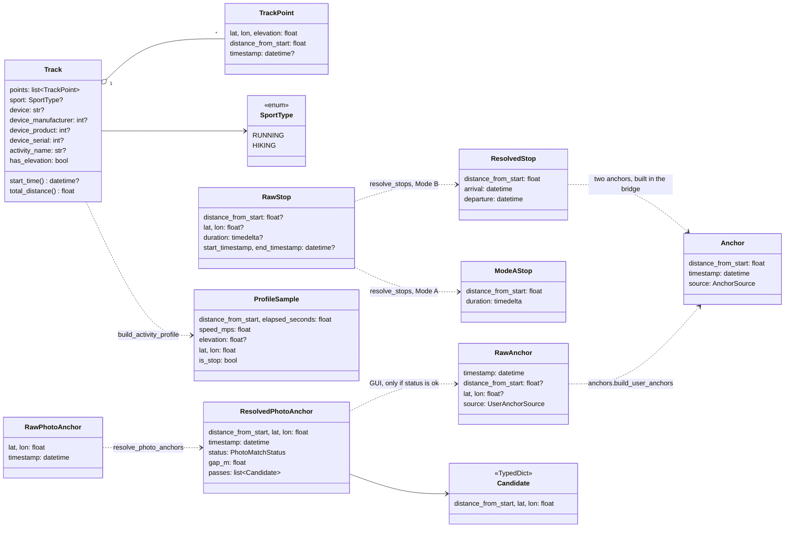

The string fields are `Literal` aliases, so `pyrefly check` rejects a
misspelt value or key:

| Alias              | Values                                                                                               |
|--------------------|------------------------------------------------------------------------------------------------------|
| `AnchorSource`     | `start`, `end` (the boundary anchors), `user`, `photo`, `stop_arrival`, `stop_departure`             |
| `UserAnchorSource` | `user`, `photo`: the only ones the GUI sends; `bridge_api` refuses anything else with a `ValueError` |
| `PhotoMatchStatus` | `outside_activity_time`, `too_far`, `at_route_end`, `ambiguous`, `ok`, in the order they're checked  |

`Candidate` is a `TypedDict`, not a dataclass, because it crosses the bridge
as it is (keys and all), matching `candidatePicker.js`'s typedef.

Invariants that the rest of the code relies on:

- `TrackPoint.distance_from_start` is the cumulative **3D** distance
  (gpxpy's 3D formula, `gpxpy.geo.distance`), measured from the cleaned
  elevations below, never the file's own: a −32768 sentinel used to make a
  leg kilometres long. With no elevation it is 2D. It never decreases.
  Gradients are therefore rise over slope distance.
- A missing `<ele>`, or one outside −500…9000 m (a writer's "no data"
  sentinel such as −32768), inherits the previous point's elevation. Points
  before the first usable one take that first value. With no usable
  elevation anywhere, every point gets `0.0` and `Track.has_elevation` is
  False, which is what `fit_writer` and `activity_profile` check to leave
  altitude out (a real `0.0` is sea level).
- Climb totals (the FIT's `total_ascent`, the sidebar's Elevation stat) come
  from `gradient.elevation_gain`, which ignores wiggles under 5 m. Summed raw
  point deltas count DEM rounding as climb.
- `timestamp` is `None` from parsing until `combine()` sets it.
- A **stop** is a pair of points at the same distance: the original point
  and a duplicate inserted right after it. The zero-distance leg between
  them is the stop's duration. `combine`, `fit_writer` and
  `activity_profile` all detect a stop with the same test: *a zero-distance
  leg that takes time*.
- Mode A stop: the user gave only a duration, and `combine()` derives the
  arrival from the pacing model. Mode B stop: the user gave explicit arrival
  and departure times, which become two `Anchor`s.

---

## 2. Module by module

### 2.1 Import graph inside `core/`

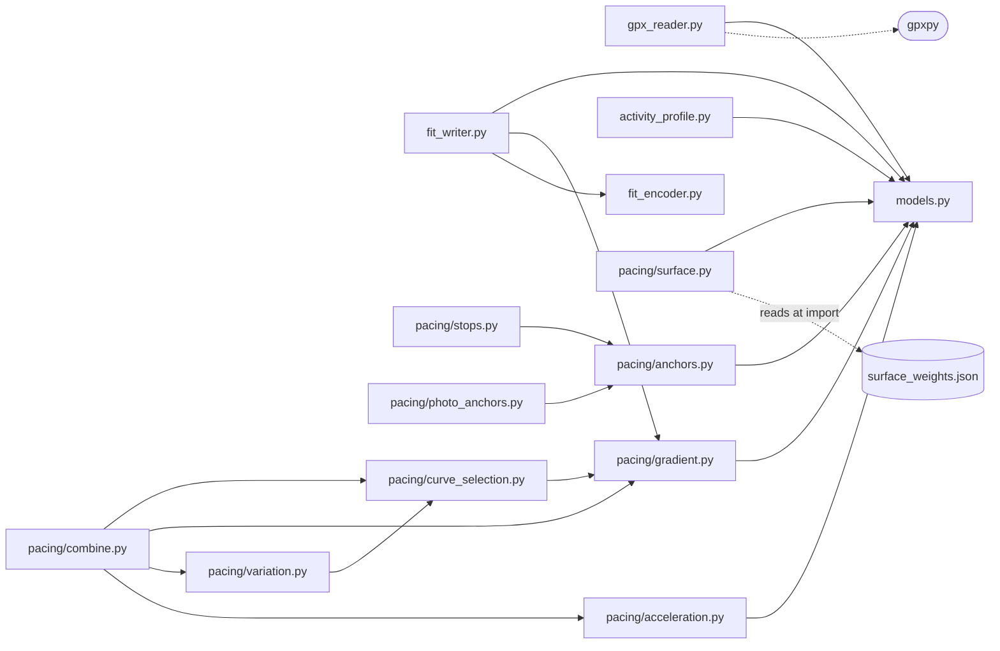

`models.py` also defines `InputError`, a subclass of `ValueError` (see
[ARCHITECTURE.md §6](ARCHITECTURE.md#6-errors)).

`combine.py` is the only module that brings the pacing pieces together.
`surface.py` is not imported by `combine`. The bridge calls it and passes
the resulting multipliers to `combine()` as a plain list. `anchors.py`,
`stops.py` and `photo_anchors.py` never call pacing code.

### 2.2 `gpx_reader.py`

```
parse_gpx_bytes(gpx_bytes, device=None, *, max_leg_m=MAX_LEG_M, warnings=None) -> Track
  bytes ─decode utf-8─▶ gpxpy.parse ─▶ for track/segment/point:
      implausible elevation → missing, carry-forward, leading back-fill,
      cumulative 3D distance from those cleaned elevations,
      join to the previous segment wider than SEGMENT_GAP_WARNING_M (100 m) → noted
  ─▶ densify_points(points, max_leg_m)   (skipped when max_leg_m is None)
  ─▶ Track(points, device = device or <gpx creator>, has_elevation)
  appends to warnings: one message if any segment join was a gap
  raises InputError: not UTF-8 · not GPX · no track points · one point · no length

densify_points(points, max_leg_m) -> list[TrackPoint]
  each leg longer than max_leg_m ─▶ ceil(leg / max_leg_m) equal pieces,
      lat/lon/elevation/distance_from_start interpolated linearly
  the original point objects are kept, unchanged and in order
```

Segments are always concatenated, and a gap is joined with a straight leg
that is paced like the rest. The warning only tells the user it happened.

**Densifying (2026-10-08).** Every leg longer than `MAX_LEG_M` (2 m) is
split into equal pieces on the straight line between its points, since a GPX
says nothing about the path between them. Pacing works per leg. On a sparse
planner GPX (legs of 100 m or more), speed used to step at each point, and
the gradient window and the pace wander had nothing to smooth. Anchors,
photos and stops also snapped up to half a leg away. 2 m (it was 15 m at
first) is short enough for the acceleration limit (§2.10) to ramp a change
of speed across several legs. The tuning harness densifies the same way. A
dense GPX is left as it is. Every later step uses the dense track:
nearest-point lookups, pacing and the FIT file. The map doesn't:
`bridge_api.parse` reads the file with `max_leg_m=None`, sends those points
to the map, and densifies the route it keeps itself, which gives exactly
the track the default would. The Valhalla request doesn't: it is thinned back to a point every
15 m (§2.8).

It reads only `<trk>` points. Route (`<rte>`) and waypoint elements are
ignored.

### 2.3 `pacing/anchors.py`: finding points and building anchors

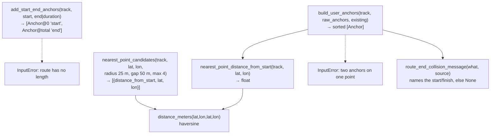

`nearest_point_candidates` is how out-and-back routes are handled. It finds
the closest point, collects every point within 25 m of it, and splits them
into clusters wherever the distance along the route jumps by more than
50 m. Each cluster is one pass of the route, and one representative per
pass is returned. A normal route always returns exactly one candidate.

### 2.4 `pacing/stops.py`

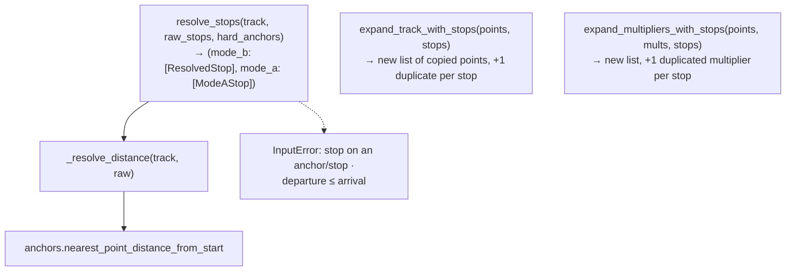

Both `expand_*` functions return new lists. `_track.points` is never
changed, because the bridge reuses `_track` for every conversion: every
point is copied, so `combine()` stamping the working track's timestamps
never reaches `_track`. A stop's distance must equal an existing point's distance
exactly. That's guaranteed because the GUI always sends a distance that
Python itself returned.

### 2.5 `pacing/photo_anchors.py`

```
resolve_photo_anchors(track, raw_photo_anchors, max_match 150 m,
                      activity_start?, activity_end?)
  for each photo:
     nearest_point_candidates → pick the candidate closest to the photo's GPS
     passes = the candidates that aren't a route end
     status = "outside_activity_time"  unless start < capture time < end, no padding  (checked first)
            | "too_far"                if gap > 150 m
            | "at_route_end"           if the match is the first or last point (the start/end anchors sit there)
            | "ambiguous"              if more than one pass: on an out-and-back the passes are metres
                                       apart, so the GPS can't tell; the user picks from `passes`
            | "ok"
  → [ResolvedPhotoAnchor]   (never raises for a bad match; the caller decides)
```

### 2.6 `pacing/gradient.py`: terrain to relative speed

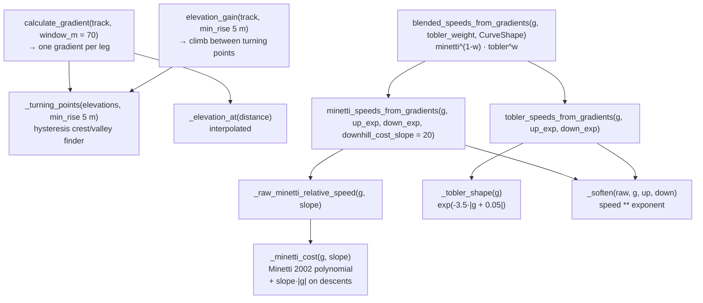

- **Window.** Each leg's gradient is rise over run across a 70 m window
  centred on the leg. Near a detected crest or valley, the window shrinks
  symmetrically so that it ends at the turning point, but not below 30 m.
  Past that limit it slides away from the turning point instead. At the
  track's ends it slides inward at full length.
- **Curves are relative.** Every curve returns 1.0 on flat ground, so every
  blend of them does too. Absolute speed comes later, when `combine` scales
  each segment to its duration.
- **Softening.** `speed ** exponent` scales log-speed linearly. That's why
  `curve_selection` can fit the exponents directly to a log-space bound.
- **Descent cost slope.** `MINETTI_DOWNHILL_COST_SLOPE` sets where Minetti's
  descents turn slower than flat. The app always uses the default; the
  `downhill_cost_slope` argument exists so the tuning harness can fit it.

### 2.7 `pacing/curve_selection.py`: three per-workout decisions

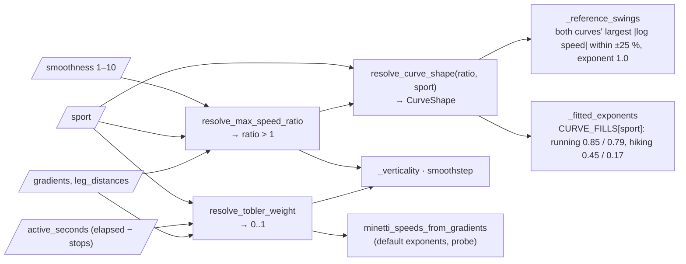

| Decision                                                      | Inputs                                    | How                                                                                                                                                                                                                                                                                                                                                                                                                             |
|---------------------------------------------------------------|-------------------------------------------|---------------------------------------------------------------------------------------------------------------------------------------------------------------------------------------------------------------------------------------------------------------------------------------------------------------------------------------------------------------------------------------------------------------------------------|
| **Tobler weight** (how much walking curve to mix in)          | flat-equivalent speed, verticality, sport | Flat-equivalent speed = `Σ(leg_distance / minetti_speed) / active_seconds`, i.e. the speed with the terrain divided out. Verticality is the distance-weighted mean `                                   \|gradient\|`. Each is ramped through a `smoothstep` band around the sport's `TOBLER_THRESHOLDS`, and the result is the `max()` of the two. Minetti is always the probe curve.                                           |
| **Max speed ratio** (how far a leg may swing from the median) | verticality, sport, smoothness            | Ramps from `MAX_SPEED_RATIO_BOUNDS[sport].flat` to `.hilly` around `HILLY_VERTICALITY` (0.06 ± 0.04), then raised to `SMOOTHNESS_SCALES[level]`. Level 5 leaves it unchanged.                                                                                                                                                                                                                                                   |
| **Curve shape** (exponents for both curves)                   | max speed ratio, sport                    | Exponents are chosen so that each curve's largest log-speed between flat and ±25% grade equals the sport's `CURVE_FILLS` share `× log(ratio)`. For a curve that keeps slowing, that is its value at ±25%; a curve that peaks and turns back is measured at the peak, so crossing flat speed near 25% can't blow the exponent up. The curve and the bound always narrow together, and the soft clamp only has to catch outliers. |

`CURVE_FILLS`, `MAX_SPEED_RATIO_BOUNDS` and `HILLY_VERTICALITY` are fitted by
the tuning harness (2026-09-29). `TOBLER_THRESHOLDS` and the band widths are
still first guesses.

### 2.8 `pacing/surface.py`

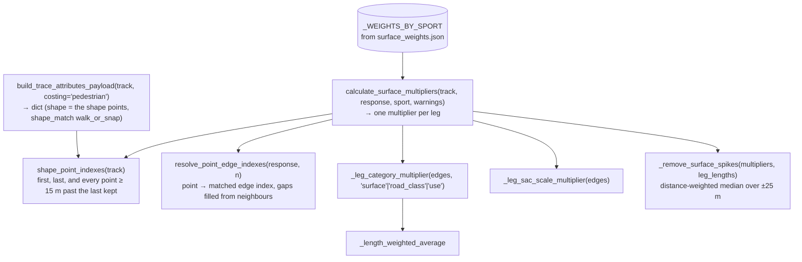

Valhalla gets a thinned shape: `shape_point_indexes` keeps the first and
last points and every point at least `SHAPE_SPACING_M` (15 m) past the
previous one kept. The track is densified to 2 m legs, and a point per leg
would cost a 25 km route ~12,500 shape points (Valhalla's default limit is
16,000) for nothing, since densified points lie on straight lines. Each
multiplier below is worked out per *shape leg* (between two shape points)
and given to every track leg inside it.

For each shape leg: `physical = 0.5·surface + 0.3·use + 0.2·road_class`. If the
leg has a SAC scale, one of two things happens:

- The SAC factor replaces `physical` outright when it's severe (≤ 0.85) and
  within 0.25 of `physical`.
- Otherwise, it's blended in: `0.7·sac + 0.3·physical`.

A leg with no matched edge gets 1.0, and so does a leg whose matched edges
run backwards (a matching glitch; it used to raise and cost the whole route
its surfaces). When those legs add up to `SURFACE_FALLBACK_WARNING_SHARE`
(10%) of the distance or more, a warning is appended.

Last, `_remove_surface_spikes` gives each leg the distance-weighted median
of the multipliers within ±`SURFACE_SPIKE_HALF_WINDOW_M` (25 m). A surface
feature shorter than that (a road crossing, a matching glitch) takes its
surroundings' value; longer ones, and the steps between them, are unchanged.

The HTTP request
itself is made in `pyodideBridge.js`, which also turns a failed request into
a warning (`describeSurfaceFailure`).

### 2.9 `pacing/variation.py`: pace wander on steady stretches

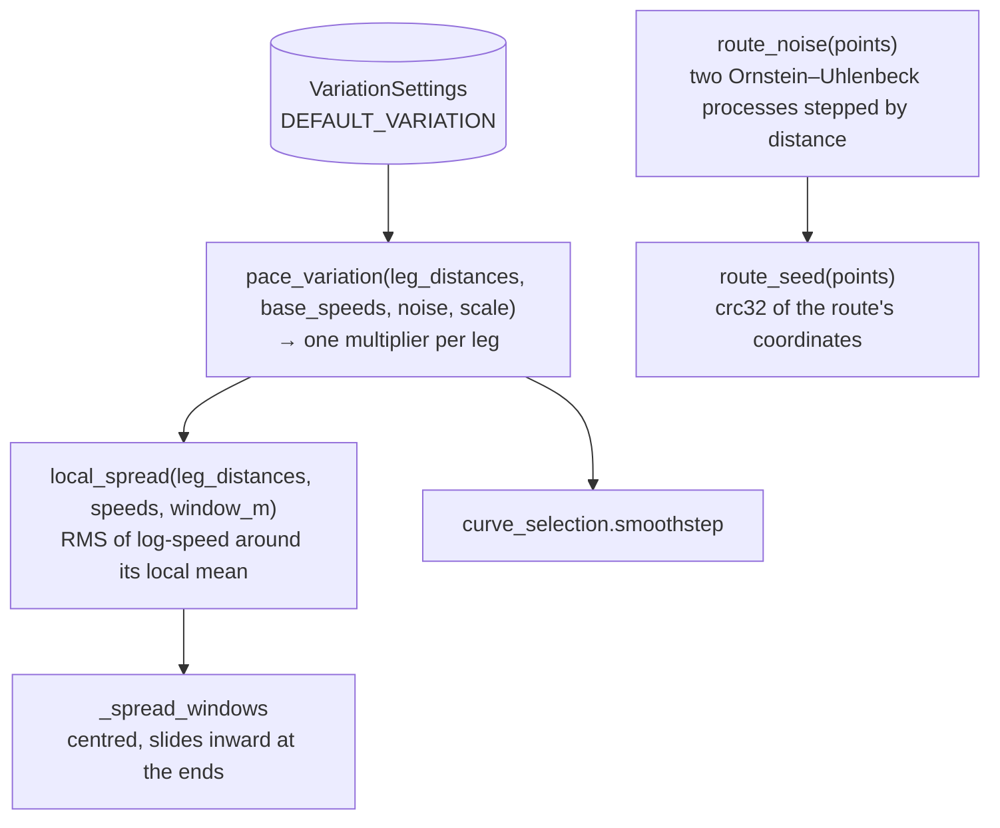

The gradient curves map terrain to speed, so a flat road or an even climb
comes out at one constant speed. `combine()` builds these multipliers once,
over the whole track, from the speeds `_pace_segment` starts from (the
blended curve × surface). The steps:

- `local_spread` measures how much those speeds vary within a centred
  150 m window (`window_m`, ±75 m).
- Where they hold one value, a leg gets the full amplitude
  (`sigma`, 0.06 in log-speed). It ramps to none across
  `steady_spread ± steady_band`. Terrain that already varies the pace
  gets no noise.
- `scale` is the smoothness level's `SMOOTHNESS_SCALES` factor, the same
  factor that scales the gradient swing.

The noise is deterministic. It is seeded from the route's coordinates and
stepped by distance. A zero-distance leg (a stop's duplicate point) keeps
its value and draws nothing. So converting again, moving an anchor or adding
a stop never reshuffles it, and its statistics don't depend on how densely
the GPX is sampled.

### 2.10 `pacing/acceleration.py`: no sudden changes of speed

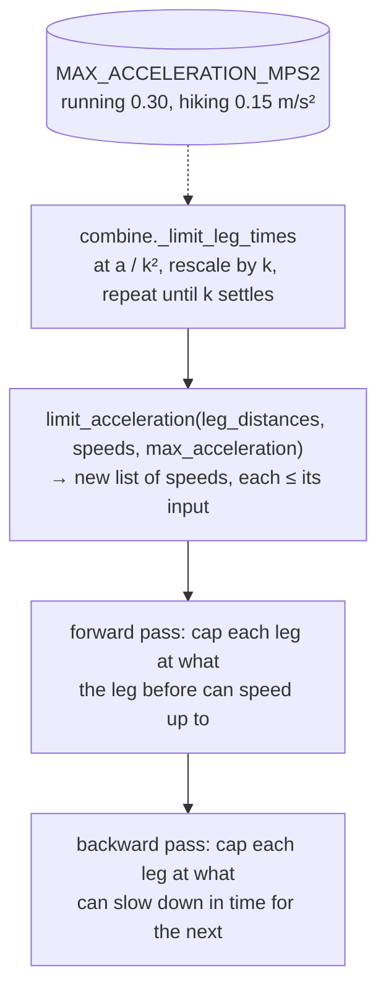

Each leg is paced at one speed, so a surface change, a hilltop or a valley
floor used to be a jump between two 1 Hz records. The limit turns each jump
into a ramp:

- **Constraint.** Between two adjacent moving legs, measured between their
  midpoints: `|v₂² − v₁²| ≤ a · (Δs₁ + Δs₂)`. At constant acceleration v² is
  linear in distance, so this is exact. `a` is the sport's
  `MAX_ACCELERATION_MPS2` (first guesses, about a 3 s transition for a
  typical step).
- **Envelope.** Each modeled speed is a ceiling, the most its terrain
  allows. The result is the fastest profile under every ceiling that keeps
  the limit, found by one forward and one backward pass. Speeding up onto
  faster terrain starts where it begins. Slowing down for slower terrain is
  finished by the time you reach it. A short fast patch peaks lower, and
  only on the patch. A short slow patch is crossed at its own speed. Every
  lowered leg is exactly at the limit against a neighbor, and legs already
  within the limit come back bit for bit.
- **Stops.** There is no constraint across a zero-distance leg, so a stop
  still starts and ends instantly.

### 2.11 `pacing/combine.py`: fitting the model to the anchors

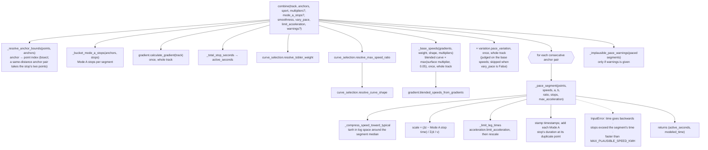

Within one segment, `_pace_segment` does the following, in order:

1. Stamp the first and last points from the two anchors.
2. Take its slice of the whole track's `v_i` = blended curve speed ×
   surface multiplier (`_base_speeds`) × pace-variation multiplier (see
   §2.9; 1.0 wherever the pace already varies). `combine` builds these once,
   so the variation judges steadiness on exactly the speeds the segments are
   paced from.
3. Compress `v_i` toward the segment median with
   `median · exp(L · tanh(ln(v/median) / L))`, where `L = ln(max_ratio)`.
   This is a soft clamp, so it never produces a flat plateau.
4. Modeled time per leg is `d_i / v_i`. Scale all of them so they add up
   to the segment's active time. Before that, a segment of at least
   `PLAUSIBILITY_MIN_SEGMENT_M` whose active time means an average over
   `MAX_PLAUSIBLE_SPEED_KMH` (60 km/h) is an `InputError` naming its two
   anchors. That catches a mistyped time, which used to reach
   `fit_encoder` as a speed too big for a FIT record. Shorter segments
   aren't judged, since a photo a second after the start but matched 50 m
   along is only GPS error.
5. Unless `limit_acceleration=False`, limit the now absolute speeds to the
   sport's `MAX_ACCELERATION_MPS2` (§2.10) and rescale the times to the
   active time again. Limiting only slows legs, so the rescale speeds every
   leg up by one factor k ≥ 1, which steepens each ramp by k². So the limit
   is applied at `a / k²`, with k found by fixed-point iteration from 1
   (a few rounds on a real route). Each segment is limited on its own, so
   the step at an anchor stays.
6. Walk the legs, adding the time. When the walk crosses a Mode A stop's
   zero-distance leg, add the stop's duration to that point and every later
   point.

Gradients, base speeds and the pace variation are computed once for the
whole track and then sliced per segment, so none is cut off at an anchor.

Each segment is scaled on its own, so a misplaced anchor shows as a step in
pace. That is inherent, so instead of smoothing it away `combine()` reports
it. `modeled_time` is in flat-equivalent metres (the curves are 1.0 on the
flat), which makes `active_seconds / modeled_time` a terrain-adjusted pace:
- A segment of at least `PLAUSIBILITY_MIN_SEGMENT_M` (300 m) whose
  terrain-adjusted pace is more than `IMPLAUSIBLE_PACE_RATIO` (2.5×) faster or
  slower than the workout's (Σactive / Σmodeled) gets a warning naming its
  two anchors. A slow climb doesn't count, since the terrain is divided out.
- Two adjacent segments flagged in opposite directions get one warning,
  naming just the anchor between them: that is the time to check.
- The warning never changes the pacing.
`tests/tuning/test_model_mirror.py` pins this function's exact output. See
[ARCHITECTURE.md §7](ARCHITECTURE.md#7-the-tuning-harness).

### 2.12 `fit_writer.py`

```
write_fit(track, *, resample=True, record_interval_s=None) -> bytes
  _build_content(track) -> _FitContent      every value decided here
    validate: every point has a timestamp, end > start
    spans = _resample(points, interval_s)  whole-second grid, RECORD_INTERVAL_S[sport] apart, split at stops
          | _per_point(points)        resample=False: one sample per point (tuning tests only)
  _encode(content) -> bytes                 fit_encoder.FitEncoder
    file_id (manufacturer/product = track.device_manufacturer/_product, or DEVELOPMENT/0 when None;
             serial only if track.device_serial; product_name = track.device)
    sport (RUNNING | WALKING for hiking)
    event START
    per span: [event STOP_ALL + START between spans]  add_many(record: ts, lat, lon, alt if has_elevation, distance, speed)
    event STOP_ALL
    lap + session (elapsed, timer = elapsed − paused, distance, ascent = elevation_gain, avg/max speed)
    activity
    → FitEncoder.to_bytes()
```

Records are on a grid of whole seconds, `RECORD_INTERVAL_S[sport]` apart
(running 2 s, hiking 3 s, running's when the track has no sport), because FIT timestamps are whole seconds: a record per point would give a dense GPX several records on one second (a
distance jump in no time) and a sparse one records 30+ s apart. Each record
is interpolated in time inside the leg it falls in and carries that leg's
paced speed. A stop splits the track into spans, and nothing is recorded
while stopped. Span ends round to the nearest second and always get a record, even off
the interval; the grid restarts at each span's start. A stop that rounds
to no time isn't a pause. The records, timer events and summaries all use
those rounded times. The timer events are what make Strava count stops as
stopped rather than as slow moving time.

### 2.13 `fit_encoder.py`

```
crc16(data, crc=0) -> int              FIT's CRC-16 (CRC-16/ARC), byte table
file_header(data_size) -> bytes        12 bytes, no header CRC
encode_value(field, value) -> int      round((v + offset) * scale), int() if unscaled; ValueError if out of range
encode_string(value, min_size)         UTF-8 + NUL, zero-padded
FILE_ID, SPORT, EVENT, RECORD, LAP, SESSION, ACTIVITY   MessageSpec: global id + fields in profile order
FitEncoder
  add(spec, values)                    one message; None fields left out
  add_many(spec, names, rows)          records: one definition check, one struct pack per row
  to_bytes()                           header + messages + file CRC
```

It writes exactly the bytes fit_tool's `FitFileBuilder` wrote for the same
messages, since Strava has accepted that layout: every message on local type
0, re-defined whenever the message changes. fit_tool is now only the tests'
oracle (`tests/core/fit_tool_reference.py`). A 7 h hike at 1 Hz takes about
0.19 s in Pyodide, against about 10 s with fit_tool.

### 2.14 `activity_profile.py`

```
build_activity_profile(track, max_samples=1000) -> [ProfileSample]
  bucket legs by ~total_distance/1000 m → one sample per bucket (true distance/time speed)
  a stop leg closes the bucket and emits two zero-speed samples (arrival, departure, is_stop=True)
```

The chart in the GUI only handles presentation. All the reduction happens
here, in Python.

---

## 3. Data flow through `core/`

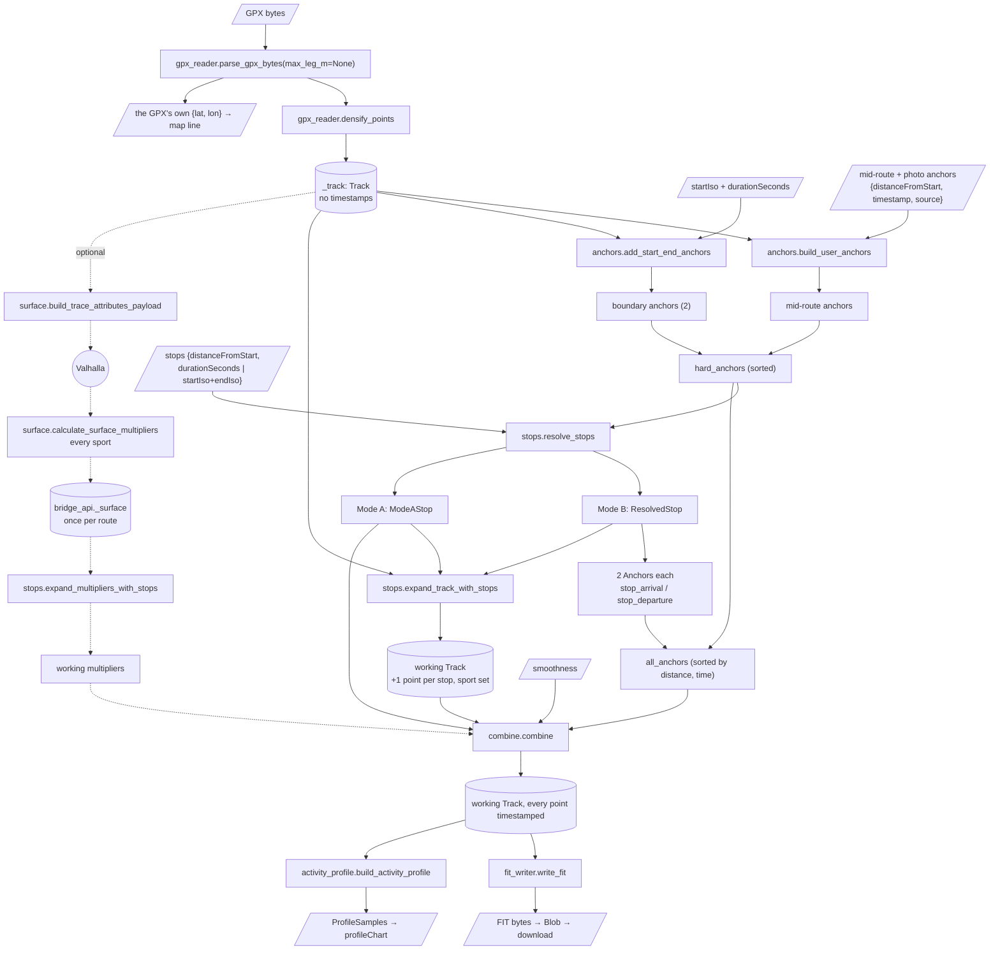

---

## 4. Inside `bridge_api.convert()`

This is the order `bridge_api.convert(request)` runs in. It first turns
the request's dicts and ISO strings into dataclasses, and the sport name
(`"running"`/`"hiking"`, the GUI's own) into a `SportType`. The surface
and `combine` append to a fresh `warnings` list per call, in that order,
and the JS side puts a failed lookup's warning (`describeSurfaceFailure`)
ahead of them.

1. `boundary = add_start_end_anchors(_track, start, duration=…)`
2. `mid_route = build_user_anchors(_track, raw_anchors, existing_anchors=boundary)`.
   The GUI always sends `distanceFromStart`, so no lat/lon lookup happens
   here. Each anchor's `source` must be `"user"` (or absent) or `"photo"`
   (`_anchor_source`); anything else is a JS bug and raises a plain
   `ValueError`, not an `InputError`.
3. `hard_anchors = sorted(boundary + mid_route)`
4. `resolved_mode_b, mode_a_stops = resolve_stops(_track, raw_stops, hard_anchors)`
5. `all_anchors = sorted(hard_anchors + stop_arrival/departure anchors)`
6. `working_track = Track(expand_track_with_stops(_track.points, all_stops), sport, device, name, has_elevation)`,
   where `device` is the request's `device.name` or `_track.device`, plus the three device IDs.
   They go on the working track, never on `_track`, so clearing the device
   between two conversions of one route really clears it
7. If the request's `surfaceLookup` is set and multipliers are kept
   (`store_surface_response`, once per route, ran
   `calculate_surface_multipliers(_track, answer, sport, warnings=…)` for
   every sport): `_surface[sport]`'s warnings are added to `warnings`, then
   `working_multipliers = expand_multipliers_with_stops(...)` on its
   multipliers.
   Otherwise `None`, i.e. gradient alone
8. `combine(working_track, all_anchors, sport, working_multipliers, mode_a_stops, smoothness, warnings=warnings)`
9. `write_fit(working_track)` → `fitBytes`
10. `build_activity_profile(working_track)`, converted to camelCase dicts
    → `profile`

Surface multipliers are computed against `_track` (not yet expanded), and
only then expanded to match `working_track`. Every conversion builds a fresh
working track, so the same `_track` can be converted any number of times.
The surface multipliers are kept for the same reason: Valhalla's answer
depends only on the route, so `store_surface_response` works out every
sport's multipliers once, and a re-conversion (a moved anchor, another
sport) only looks them up. `parse` clears them with the route. An answer
that raises while being read keeps nothing, and the next conversion asks
again.

---

## 5. Tests

pytest, in `tests/core/` and `tests/core/pacing/`, covers every `core`
module, including `bridge_api` (`test_bridge_api.py`: each call's result
shape and the route kept between calls), plus `test_bridge_core_files.py`
(every `core/` file is in `pyodideBridge.js`'s `CORE_FILES`). Shared track
builders live in `tests/core/conftest.py`.

The harness's own tests are in
[TUNING_ARCHITECTURE.md §13](TUNING_ARCHITECTURE.md#13-tests).

---

## 6. Change checklists

**Adding a module under `core/`**
- Add it to `CORE_FILES` in `pyodideBridge.js` (`tests/core/test_bridge_core_files.py` fails until you do).
- If the GUI needs to call it, add a function to `bridge_api.py` (with a
  test) and one export to `pyodideBridge.js` that `callBridge`s it. Don't
  run Python source from JS.
- Keep it free of I/O and native extensions.
- Use `models.py` types.

**Changing `_pace_segment` or the curve functions**
- Update `tuning/model.py` until `test_model_mirror.py` passes (see
  [TUNING_ARCHITECTURE.md §8](TUNING_ARCHITECTURE.md#8-modelpy-the-pacing-model-with-its-constants-as-arguments)).

**Adding a user-fixable validation**
- Raise `InputError` with a message written for the user.
