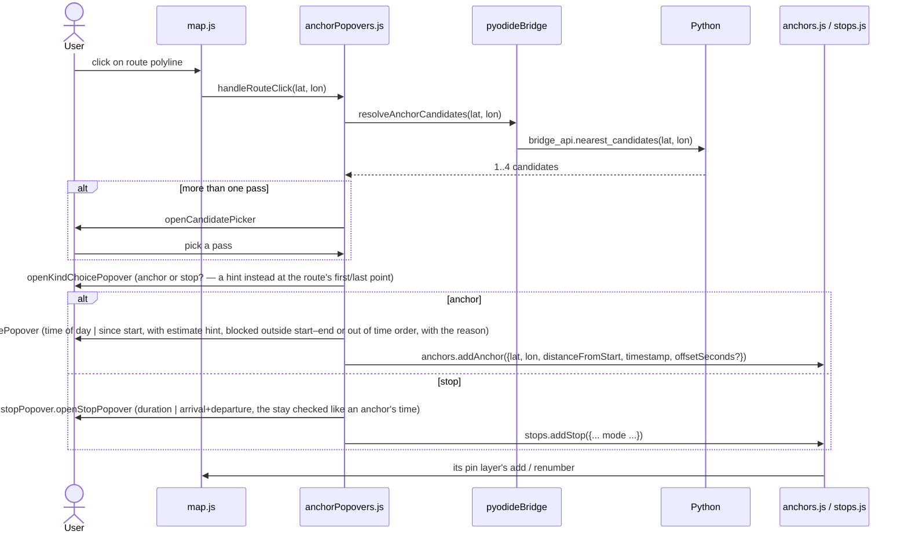

# GUI architecture

The browser side of the app: `src/gpx2fit/gui/js/`, plain ES modules with no
build step. It covers the module graph, who owns which state, the
interaction flows and the smaller modules. The design rules, the repository
map (including the `js/` folders), the bridge into Python and the error
channels are in [ARCHITECTURE.md](ARCHITECTURE.md), the Python side in
[CORE_ARCHITECTURE.md](CORE_ARCHITECTURE.md). Diagrams are Mermaid, which
GitHub renders. In PyCharm, enable Mermaid in *Settings → Languages &
Frameworks → Markdown*.

Contents

1. [Module dependency graph](#1-module-dependency-graph)
2. [Who owns which state](#2-who-owns-which-state)
3. [Interaction flows](#3-interaction-flows)
4. [Smaller modules](#4-smaller-modules)
5. [Tests](#5-tests)
6. [Change checklists](#6-change-checklists)

---

## 1. Module dependency graph

```mermaid
flowchart TD
  main["main.js<br/>entry, wiring, upload + convert handlers"]
  as["appState.js<br/>route, sport, start time, activity window"]
  stt["status.js<br/>the status line"]
  set["settings.js<br/>surface + smoothness, remembered"]
  bridge["pyodideBridge.js"]
  map["map.js<br/>Leaflet map, route, pin layers,<br/>hover marker, the desktop popup"]
  ph["popoverHost.js<br/>Leaflet popup or the phone's #routeDialog"]
  ap["anchorPopovers.js<br/>route-click flow: anchor-or-stop →<br/>anchor time popover,<br/>placePhoto card for a location-less photo,<br/>choosePhotoPass for an ambiguous one,<br/>confirm a dragged photo pin's move"]
  sp["stopPopover.js<br/>duration or arrival + departure"]
  cp["candidatePicker.js<br/>Which pass?"]
  tc["timeChecks.js<br/>inside start–end and in time order?"]
  pe["placementEstimates.js<br/>uniform-pace estimate, time pre-fill"]
  ppart["popoverParts.js<br/>heading, hint, buttons, photo header"]
  ppl["photoPlacement.js<br/>pending photo, likely pass by photo time"]
  ao["anchorOrder.js<br/>is a point in time order?"]
  anchors["anchors.js<br/>createAnchorList"]
  stops["stops.js<br/>createStopList + change listener"]
  ml["markerList.js<br/>shared list+pin bookkeeping, pins injected"]
  aw["activityWindow.js<br/>is an anchor/stop inside start–end?"]
  photo["photoAnchors.js<br/>createPhotoDrop: EXIF via exifr → resolve → addAnchor"]
  ti["timeInput.js<br/>createTimeToggle (duration / end / avg speed)"]
  se["speedEntry.js<br/>avg-speed boxes, unit, quick-picks"]
  dtf["dateTimeField.js<br/>custom date + time fields, segment linking"]
  pp["profilePanel.js<br/>createProfilePanel: slide-up panel, toggles"]
  pc["profileChart.js<br/>SVG chart"]
  mob["mobileLayout.js<br/>phone scroll sheet"]
  sc["shortcuts.js<br/>global keys + ? panel"]
  dp["devicePicker.js<br/>device button + &lt;dialog&gt;"]
  dev["devices.js<br/>catalog, validation, storage"]
  th["theme.js<br/>light/dark"]
  gl["glass.js<br/>liquid-glass refraction switch"]
  rf["rangeFill.js<br/>smoothness slider's center-biased fill"]
  fmt["format.js<br/>formatting + describeError"]
  cfg["config.js<br/>Thunderforest key (gitignored)"]
  subgraph shared["shared UI helpers"]
    seg["segmented.js<br/>radio groups and tabs"]
    fd["focusDropdown.js<br/>quick-pick lists"]
    num["numericInput.js<br/>digits-only boxes, Up/Down"]
    dz["dropzone.js<br/>drop + click-to-browse"]
    dates["dates.js<br/>calendar-day arithmetic"]
    st["storage.js<br/>remembered settings"]
    css["cssVars.js<br/>theme colour tokens"]
    dom["dom.js<br/>checked element lookups"]
  end

  main --> bridge
  main --> map
  main --> as
  main --> stt
  main --> set
  as --> aw
  set --> st
  set --> rf
  main --> ti
  main --> dtf
  main --> anchors
  main --> stops
  main --> ap
  main --> photo
  main --> pp
  main --> sc
  main --> dp
  dp --> dev
  dp --> num
  dp --> st
  main --> seg
  main --> dz
  main --> th
  main --> gl
  main --> fmt
  main --> mob
  main --> ph
  mob -. "mapModule injected" .-> map
  ph -. "map, isPhoneLayout injected" .-> map
  ml -. "a pin layer (map.createPinLayer)<br/>and revealMap injected" .-> map
  ap -. "appState, anchors, stops, map, popovers,<br/>resolveAnchorCandidates, revealMap,<br/>setStatus injected by main" .-> bridge
  ap -. "popovers injected,<br/>handed on to the stop popover and picker" .-> ph
  ap --> ti
  ap --> sp
  ap --> cp
  ap --> tc
  ap --> pe
  ap --> ppart
  sp --> ti
  sp --> seg
  sp --> pe
  sp --> ppart
  sp --> tc
  cp --> ppl
  cp --> ao
  cp --> ppart
  tc --> aw
  tc --> ao
  pe --> dates
  anchors --> ml
  stops --> ml
  anchors --> aw
  stops --> aw
  ap --> aw
  ap --> ppl
  ap --> ao
  ao --> fmt
  main --> aw
  pp --> pc
  pp --> seg
  photo --> dz
  pp -. "map injected (hover dot)" .-> map
  photo -. "appState, resolvePhotoAnchors, addAnchor,<br/>setStatus, a pin layer injected by main" .-> bridge
  photo -. "placePhoto, cancelPhotoPlacement,<br/>choosePhotoPass injected by main" .-> ap
  anchors -. "drag-end listener<br/>set by main" .-> ap
  ti --> dtf
  ti --> seg
  ti --> se
  ti --> num
  ti --> dates
  se --> fd
  se --> num
  se --> dtf
  dtf --> fd
  dtf --> dates
  th -. "onChange: map.setTheme, set by main" .-> map
  th --> st
  th --> css
  map --> css
  map --> cfg
  pc --> fmt
  photo --> fmt
  ti --> fmt
```



`anchorPopovers.js` and `photoAnchors.js` follow one rule: pure helpers
(formatting, the time controls, the order and window rules) are imported,
and everything with state or side effects is passed in by `main.js`.
`createAnchorPlacer` receives `appState`, the `anchors` and `stops` lists,
`map` (only for the placement mode), `popovers`, `resolveAnchorCandidates`,
`revealMap` and `setStatus`, so its tests pass in fakes, including a
`popovers.open` that builds into a plain `<div>`. It hands what the stop
popover and the pass picker need (`popovers`, `appState`, `stops`, its
`createTimeChecks` and its estimate) on to `openStopPopover` and
`openCandidatePicker` when it opens them.
`photoAnchors.js` receives `appState`, `resolvePhotoAnchors`, `addAnchor`,
`placePhoto`, `cancelPhotoPlacement`, `choosePhotoPass`, `setStatus` and
`unresolvedPins` (a pin layer of its own, `map.createPinLayer()`, for the
"!" pins of photos waiting to be resolved), so
its tests pass in fakes (and a real `createAppState()`). Every photo anchor, GPS-matched or placed by hand, is
added there, with its `thumbnailUrl` and an `onRemove` hook
(`markerList.add(fields, { onRemove })`) that drops the photo when the
anchor is deleted from the anchor list. A photo that became an anchor is
listed only there; the Photos list keeps the ones that still need the user. `main.js` also hands
`anchorPlacer.handleAnchorDrag` to `anchors.setAnchorDragEndListener`, so a
dropped photo pin goes through the same confirm flow.

The same rule holds below them (since 2026-10-12): no module but `main.js`
imports `map.js`, and `map.js` imports only `config.js` and `cssVars.js`.
- **Lists.** `createAnchorList`/`createStopList` each get their own pin layer
  (`map.createPinLayer()`) and `revealMap`, and hand both to
  `createMarkerList`. A pin layer is the list's `PinLayer`: add, move,
  remove, renumber, panTo, highlight, setDimmed, all by the list's own ids.
  Each list has its own id space, so stops no longer need an id offset, and
  the list tests pass a fake layer instead of mocking `map.js`.
- **Popovers.** `createPopoverHost({map, dialogEl, isPhoneLayout})` opens the
  content in `map.openPopup` on a desktop and in `#routeDialog` on a phone.
- **Theme.** `initTheme(button, {onChange})` gets `map.setTheme`, which swaps
  the tiles and recolors the route.
- **Panel and photos.** `createProfilePanel({..., map})` uses only the hover
  dot. `createPhotoDrop` and `createProfilePanel` are factories with their
  state inside, so `main.js` holds the one instance of each and calls its
  `reset()`/`hide()` on a new GPX.
- `mobileLayout.js` still receives `mapModule` to move the attribution.

---

## 2. Who owns which state

| State                                              | Owner                                                                                           | Read by                                                                                                                      |
|----------------------------------------------------|-------------------------------------------------------------------------------------------------|------------------------------------------------------------------------------------------------------------------------------|
| route points, total distance, GPX file name, sport | `appState` (`setRoute` once a parse succeeds, `setSport`)                                       | convert handler, `anchorPopovers`, `photoAnchors`; `timeInput` through `speedMode` getters                                   |
| start date/time (as typed)                         | `dateTimeField` instance in `main.js`                                                           | `main.js`'s `getStartTime()`, for the toggle while it works out its result                                                   |
| start time + duration / end / avg-speed result     | `appState.setTime(start, result)`, from `startTimeToggle`'s `onChange`                          | `appState.startTime`/`timeResult`/`activityWindow()`/`durationSeconds()`; `getResult()` again at convert time                |
| anchors                                            | `createAnchorList` in `main.js`, backed by `markerList`                                         | `getActiveAnchors()` at convert time                                                                                         |
| stops                                              | `createStopList` in `main.js`, backed by `markerList`                                           | `getActiveStops()` at convert time; `getStops()` for the avg-speed stop total; the change listener refreshes the time toggle |
| activity window (start–end)                        | derived by `appState`; `onWindowChange` pushes it into the anchor and stop lists → `markerList` | `markerList`'s `isActive` check, `getActive()` and the row text                                                              |
| parsed `Track`                                     | `bridge_api._track` (Python module state)                                                       | every bridge call                                                                                                            |
| theme, surface toggle, smoothness, device          | `localStorage`, through `storage.js`                                                            | `theme.js`, `settings.js`, `devicePicker.js`                                                                                 |

`main.js` calls `startTimeToggle.refresh()` whenever the average-speed
duration could change: after a GPX parses, on a sport change, and on any
stop change. The convert handler calls `getResult()` again rather than
trusting the cached value.

Every time that toggle reports (including after a start-time edit),
`main.js` records it with `appState.setTime(start, result)`: the start and
its result are stored together, so the window never pairs a new start with
an old end. If the window changed (`sameWindow` says otherwise), `appState`'s
`onWindowChange` listener, registered by `main.js`, pushes it into
`anchors.setActivityWindow` and `stops.setActivityWindow`, which hand it to
their `markerList` (generic over its item, so each list keeps its
`Anchor`/`Stop` type). The list re-checks every item with its `isActive`
predicate (`activityWindow.js`'s `isAnchorActive`/`isStopActive`: strictly
inside, the same rule as Python's photo check) and re-renders the rows
without renumbering the pins, since a time change can't reorder them.
Photo anchors are included: a photo outside the window at drop time is
still added (see "Dropping photos" below), so this re-check can bring it back. An item outside is kept but marked `.is-inactive`, its pin is dimmed
(its pin layer's `setDimmed`), and it is left out of `getActive*()`. Moving the
window back makes it active again. The convert status then reports how
many were left out (`format.leftOutNote`). An anchor or stop time entered
as "Duration since start" is stored with its offset (`offsetSeconds`, or
`arrival`/`departureOffsetSeconds`), so it follows the start instead of
staying at a fixed clock time. `totalStopSeconds` counts every stop, active
or not: whether a stop is active depends on the end time, which in
avg-speed mode depends on that total.

---

## 3. Interaction flows

Clicking the route:



Dropping photos:

```
main.js: photoFileInput.accept = photoAcceptFor(navigator, …)   (Chromium on Android: no camera)
photoAnchors.handleFiles            (drop, the main input = file chooser, or the gallery input)
  guard: a route is loaded
  readFile: isLikelyPhotoFile (image/*, or an untyped photo extension) → readPhotoMetadata(file)
    → exifr: {lat, lon, timestamp}, either half possibly null; plus the EXIF thumbnail for the row
    no time                → row message only ("No capture time")
    time but no GPS        → row with "Place on map" → anchorPopovers.placePhoto({timestamp, thumbnailUrl, onPlaced, onCancel})
                             map: banner + crosshair + pulsing route (photoPlacement onChange → map.setPlacementMode)
                             next route tap → (candidate picker, the photo's likely pass marked: suggestCandidate)
                             a point out of time order (anchorOrder.findOrderConflict) → a notice, still armed;
                             in the picker such a pass is disabled with the reason
                             → "Place photo here" card (time shown, not editable; outside start–end is allowed, dimmed)
                             confirm → onPlaced({lat, lon, distanceFromStart}) → addAnchor({..., source: 'photo', thumbnailUrl}, {onRemove})
  resolvePhotoAnchors(readings)     (photos with both; one batch, one bridge call, GPS only: no activity window)
  same capture time and place as a live photo → row message only (checked before matching)
  per result: ok → addAnchor({..., source: 'photo', thumbnailUrl}) · at_route_end → row message only
              too_far → row with the gap and "Place on map", the same flow as a photo with no GPS above;
                        nothing on the map until placed (its GPS may be kilometres away)
              ambiguous → row with "Resolve", and a "!" pin (unresolvedPins, kind 'photo-unresolved')
                          at the nearest pass; the button and a click on the pin both
                          → anchorPopovers.choosePhotoPass({timestamp, thumbnailUrl, passes, onPicked})
                          → "Which pass?" picker (likely pass marked, out-of-order passes disabled)
                          → onPicked(pass) → the pin goes, addAnchor (skipped if the row was removed meanwhile)
                          the row's ×, or a reset, removes the pin too
  became an anchor → row leaves the Photos list, counted by #photoSummary; the anchor list shows it
  ok but outside the current start–end → still added; one batch status says it's not used yet
  afterwards: a start/duration change re-checks the photo anchor like any other (anchors.setActivityWindow)
  anchor deleted from the anchor list → its onRemove → the photo is dropped, its thumbnail freed
  row removed (×, or a reset for a new GPX) while reading/matching → its photo is never matched or added
```

Moving a photo pin:

```
pins.add(..., {draggable})          (the anchor list's pin layer; markerList's isDraggable: anchors.js says source === 'photo')
  drag     → the pin snaps to the drawn route (L.Polyline#closestLayerPoint)
  dragend  → markerList → anchors.setAnchorDragEndListener → anchorPopovers.handleAnchorDrag(anchor, lat, lon, revert)
             resolveAnchorCandidates → (candidate picker, likely pass marked) → "Move photo?" card
             out of time order with another active anchor or stop → revert() and a notice saying which, and where to go
             Move → anchors.moveAnchor → markerList.move (re-sort, renumber) → pins.move
             anything else (Keep, ×, click elsewhere, Esc, start/finish, same point) → revert()
```

---

## 4. Smaller modules

- **`appState.js`**: `createAppState({sport})`. Plain getters (`route`,
  `sport`, `startTime`, `timeResult`), one setter each (`setRoute`,
  `setSport`, `setTime(start, result)`), the derived `activityWindow()` and
  `durationSeconds()`, and `onWindowChange(fn)`, which fires only when the
  window really moved. Tested.
- **`status.js`**: `createStatus(statusEl)` returns `setStatus(message,
  kind)`. An `'error'` or `'input'` status goes back to "Ready." after
  `STATUS_ERROR_TIMEOUT_MS`; a `'warning'` stays. Tested with mocked timers.
- **`settings.js`**: `initSurfaceLookupSetting(checkbox)` and
  `initSmoothnessSetting(slider, valueEl)` restore and store the two
  remembered conversion settings (`surfaceLookup`, `smoothness`). Tested.
- **`timeInput.js`**: `createTimeToggle({variant, speedMode?})`.
  - Variants are `durationOrEnd` (the main control), `durationOrTimeOfDay`
    (the anchor popover) and `durationOnly` (a stop's duration).
  - Every mode resolves to `{isValid, mode, resolvedDate, durationSeconds}`.
  - Average-speed mode computes
    `duration = distance / speed + total stop time` in JS. Its boxes are
    **`speedEntry.js`**'s `createSpeedEntry({getSport, onInput})` (km/h or
    min:sec, the unit button, the quick-picks), which only reads a speed.
  - `focusMode(mode)` and `nextMode()` open a tab and focus its first box,
    for the shortcuts. Tested, as is `speedEntry`.
- **Placement helpers** (`placement/`), around `anchorPopovers.js`:
  - `stopPopover.js`: `openStopPopover(candidate, deps)`.
  - `candidatePicker.js`: `openCandidatePicker({popovers, candidates,
    estimateArrival, onPick, photoTime?, conflicts?, onDismiss?})`.
  - `timeChecks.js`: `createTimeChecks({appState, anchors, stops})` returns
    `isInsideWindow`, `typedTimeProblem(distance, time, until?)` (the
    message under a typed anchor or stop time, or null) and
    `photoOrderConflict`.
  - `placementEstimates.js` (pure, tested): `estimateArrivalDate`,
    `isRouteEnd`, `toggleDefaultsFromEstimate`, `offsetSecondsOf`.
  - `popoverParts.js` (tested): `popoverHeading`, `popoverHint`,
    `estimateHint`, `confirmButton`, `optionButton`, `cardActions`,
    `photoSummary`.
  - `popoverHost.js` (tested): `createPopoverHost({map, dialogEl,
    isPhoneLayout})` returns `open(lat, lon, build, {onClose})`. On a
    desktop that is `map.openPopup`. On a phone the content goes in the
    `#routeDialog` modal instead (a popup above the sheet has no room). The
    builders get the same `(container, close, updateLayout)` either way, and
    an optional `onClose` runs once however the content goes (its `close()`,
    the ×, the backdrop, Esc, or new content replacing it). The dialog's
    `close` event arrives a task late, after a builder that closed itself to
    open the next step has reopened the dialog. So the host ends the previous
    content itself, and ignores a `close` event while the dialog is open
    again. Tested against a dialog stand-in, since jsdom has no `showModal`.
- **`anchorOrder.js`** (pure, tested): `timedPoints`, `findOrderConflict`
  (a stop's span via `until`), and the messages: `describeOrderConflict`
  (where to put a photo), `describeTimeConflict` (which way to change a
  typed time) and `describeOrderConflictBriefly` (a disabled pass).
- **`dateTimeField.js`**: custom date and time fields with quick-pick
  dropdowns. `linkSegmentPair` makes the arrow keys move between the
  hours and minutes boxes.
- **Shared UI helpers**, each tested:
  - `segmented.js`: `wireSegmented(control, onSelect, {kind})` for the
    controls in `index.html` (sport, chart unit and axis) and
    `createSegmented` for the ones built at runtime (start-time modes, the
    stop popover's modes). It owns the ARIA: `kind: 'radio'` (default) is a
    radio group, `'tabs'` a tab list whose `linkPanel(value, panel)` ties
    each tab to its panel. Both take the arrows, Home and End.
  - `focusDropdown.js`: `createFocusDropdown`, the list under the time
    fields, the speed presets and the day selector. It opens on focus (or a
    click), fills on a click and closes once focus leaves.
  - `numericInput.js`: `wireNumericBox` and `createNumericInput`, text
    boxes with digits-only entry and Up/Down stepping (see CLAUDE.md for why
    they aren't `type="number"`).
  - `dropzone.js`: `wireDropzone`/`wireFileInput` for the GPX and photo
    dropzones.
  - `dates.js`: `dayOffsetBetween`, `computeDayCount`, `toDateInputValue`.
  - `dom.js`: `requireElement(id, type)` and `requireChild(parent,
    selector, type)`, element lookups that are typed by `type` and throw
    when the markup lacks the element. `main.js` uses the first for every
    element, the popover host and device picker the second.
  - `storage.js`: `readSetting`/`writeSetting`, which never throw.
  - `cssVars.js`: `readCssVar` and `accentColor`, for what CSS can't style
    (Leaflet's route line and hover dot, the toolbar's theme-color).
- **`shortcuts.js`**: each entry in one `SHORTCUTS` array binds a key,
  renders a row in the "?" panel, carries its own `run(controls)` and lists
  the controls it advertises `aria-keyshortcuts` on (`targets`). Each run
  calls `.click()` on the existing control, or the start-time controls' own
  focus methods. Besides the sport, convert, file and device keys, Alt+N
  focuses the start date (`startTimeField.focus()`), Alt+L the duration
  (`startTimeToggle.focusMode('duration')`), Alt+K steps through the
  start-time tabs (`nextMode()`), and Alt+G hides or reopens the profile.
  `main.js` passes the wired sport control (`wireSegmented`'s handle), the
  start-time field and toggle, `appShellEl` and the profile's close/show
  buttons, so it reads no other module's markup.
- **`glass.js`**: `supportsBackdropRefraction(nav)` (true when
  `userAgentData` lists Chromium) and `initGlass()`, which sets
  `html.glass-refraction`. That turns on `index.html`'s `#liquidGlass` SVG
  filter in the floating panes' `backdrop-filter`. Tested.
- **`rangeFill.js`**: `centerBiasedFill(value, min, max, origin)` (pure) and
  `initCenterBiasedRange(input, origin)`, which keeps `--range-lo`/`--range-hi`
  on the smoothness slider so its fill grows from 5 (automatic) toward the
  knob, as in macOS 26's center-biased slider. Tested.
- **`devices.js`**: `DEVICE_CATALOG` (brand → `{name, manufacturer, product}`;
  only IDs with a real source: Garmin from the FIT SDK profile (`fit_tool`'s
  `GarminProduct`, and Garmin's `fit-javascript-sdk` for the newest), Suunto
  from its own product-ID list, other brands from a recording Strava named or
  another FIT reader's device table: GoldenCheetah, Runalyze) plus pure helpers
  (`selectionLabel`, `parseCustomIds`, `parseStoredSelection`,
  `toConvertDevice`). Tested.
- **`devicePicker.js`**: the sidebar's device button and the native
  `<dialog>` it opens with `showModal()`. Persists the choice in
  `localStorage` (`device`). Nothing is focused on open; the first Tab goes
  to the current pick, and the arrows then move over the grid through the
  exported pure `moveFocusIndex(rowLengths, index, key)`, which is tested.
  jsdom has no `showModal`, so the rest of the module is untested.
- **`theme.js`**: `initTheme(button, {onChange})` picks the stored theme, or
  the system's, sets `data-theme`, the button's icon and the toolbar tint,
  then calls `onChange(theme)`; `main.js` passes `map.setTheme`. Tested.
- **`profilePanel.js`**: `createProfilePanel({...elements, map})` returns
  `show(samples, sport)` and `hide()`. It opens two animation frames after
  `show`, defaults the unit to the sport until the user picks one, and never
  lets the last series be hidden. Tested with the real chart.
- **`profileChart.js`**: pure helpers (`niceTicks`, `linearScale`,
  `buildSeries`, `stopRuns`, `averageMovingSpeedMps`, `linePath`, …) plus
  `createProfileChart`. The pure part has tests.
- **`format.js`**: every formatter, plus `describeError(err) →
  {message, kind: 'input'|'error'}`. Clock times are always 24-hour
  (`formatClock`, and `formatDateTime` with `hourCycle: 'h23'`), and
  `formatPaceClock` is the unitless "m:ss" that `formatPace` and the
  chart's pace ticks share.
- **`mobileLayout.js`**: the phone layout (`PHONE_LAYOUT_QUERY`, ≤ 860 px,
  kept in step with `css/responsive.css`). The CSS fixes the map full-screen behind
  the sidebar, which becomes a sheet in the page's scroll. The module:
  - opens the page with the sheet half-way up
  - moves `#profilePanel` and `#profileShowButton` to the top of the sheet,
    and moves the Leaflet attribution to the top right
  - `coveredMapHeight()` tells `map.js` how much of the map the sheet hides,
    via `setBottomInsetProvider`. `renderRoute` and a pin layer's `panTo`
    then aim at the visible part.
  - `revealMap()` scrolls the sheet back to half-way. It runs after a GPX
    parses and when an anchor or stop row is clicked.
  - `isPhoneLayout()` tells the popover host where to open (see
    `popoverHost.js` above).

  The layout logic is tested against a stubbed `matchMedia`.

---

## 5. Tests

**node + jsdom, `tests/gui/<folder>/*.test.js`** (one folder per `js/`
folder; `testUtils/domSetup.js` sets up jsdom):

- **Route and lists:** `markerList` (against a fake pin layer: ids, order,
  rows ↔ pins, the window re-check, `getActive`, `countInactive`),
  `activityWindow`, `anchors` + `stops` (`anchorsAndStops`: the
  activity-window re-check and `getActive*()`, each list with its own ids),
  `anchorOrder` (the time-order rule, incl. a stop's span, and its messages).
- **Placement and photos:** `photoAnchors` (incl. `createPhotoDrop`'s
  per-status rows, the missing-location/missing-time split, thumbnails, both
  pickers, and two drops staying apart), `photoPlacement` (the pending
  "Place on map" photo and its time pre-fill), `anchorPopovers`
  (`createAnchorPlacer` against a fake map: the anchor and stop popovers'
  time checks, the pass picker, the photo cards and a dragged pin's
  confirm), `placementEstimates`, `popoverParts`, `popoverHost` (desktop
  popup or phone dialog, and `onClose` exactly once).
- **Inputs:** `dateTimeField`, `timeInput`, `speedEntry`.
- **Bridge:** `pyodideBridge` (against a fake Pyodide and a fake
  `bridge_api` that checks every proxy is destroyed).
- **State and shell:** `appState`, `status`, `settings`, `shortcuts`,
  `theme`, `glass`, `rangeFill`, `mobileLayout`.
- **Profile and devices:** `profileChart`, `profilePanel`, `devices`,
  `devicePickerNav` (`moveFocusIndex`).
- **Shared helpers:** `format`, `segmented`, `focusDropdown`,
  `numericInput`, `dropzone`, `dates`, `dom`, `storage`.

**Pages, `tests/gui/pages.test.js`:** `index.html` and `about.html` as
files: every `css/` file linked (about.css by the about page only), the
cascade order, and an integrity hash and `crossorigin` on every pinned CDN
file.

**Untested:** `map.js` (Leaflet: pins, drag and snapping, the popup),
`devicePicker.js` beyond `moveFocusIndex`, `main.js` (wiring), the
placement banner and how the popovers, rows and pins look, which have to be
checked by hand in a browser.

---

## 6. Change checklists

**Adding a stylesheet**
- Put it in `gui/css/` and link it from `index.html` before
  `responsive.css` and `glass.css`, which stay last (their overrides win by
  order). `tests/gui/pages.test.js` fails on an unlinked or missing file.

**Bumping Leaflet, exifr or Pyodide**
- Change the version and its integrity hash together (in `index.html`, or
  `PYODIDE_VERSION` and `PYODIDE_INTEGRITY` in `pyodideBridge.js`). A stale
  hash makes the browser refuse the file. See CLAUDE.md for the command.

**Adding a GUI module**
- Put it in the `js/` folder for its concern
  ([ARCHITECTURE.md §2](ARCHITECTURE.md#2-repository-map)), and its test in
  the matching `tests/gui/` folder. Only `main.js` and `config.js` sit at
  the root of `js/`: the deploy's build command writes `gui/js/config.js`.
- Add it to the graph in [§1](#1-module-dependency-graph) and, if small, to
  [§4](#4-smaller-modules).
- Give its exports JSDoc types: `npm run typecheck` checks callers against
  them. A shape another module also uses gets a `@typedef` here, and the
  others `import('…')` it.

**Giving a GUI module something with state or side effects**
- Pass it in from `main.js` (the map, a list, the popover host, the status
  line), as a factory argument, rather than importing it. Only `main.js`
  imports `map.js`. That keeps the module testable with a fake.

**Adding shared GUI state**
- Add it to `appState.js` (a getter and a setter), not as a variable in
  `main.js`, and pass `appState` to the module that reads it.

**Adding a keyboard shortcut**
- Add one entry to `SHORTCUTS` in `shortcuts.js`, with its `run` (and
  `targets`, for `aria-keyshortcuts`). It should `.click()` an existing
  control or call a method its module exposes, never query that module's
  markup.

**Adding a persisted setting**
- Read and write it through `storage.js`, and validate what you read. A
  conversion setting goes in `settings.js`, with a test.
- Update the "Only four settings" line in `about.html#privacy`.
